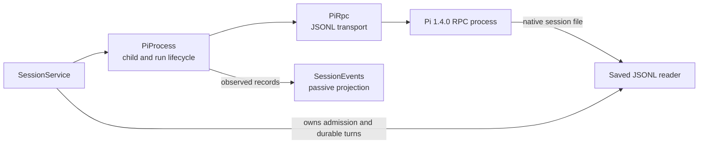

# Pi runtime boundary

English | [简体中文](../i18n/zh-CN/handbook/runtime.md)

Detailed prose walkthrough: [Implementation](implementation/runtime.md).

[Handbook index](README.md) · [Session ownership, storage, history, and events](sessions-storage.md)

Dwell runs the configured Pi 1.4.0 executable as an RPC subprocess, sends JSON Lines commands, validates the records it relies on, and observes Pi's events. Pi remains responsible for agent execution, providers, model behavior, extensions, native resources, and its session format.

## Ownership map

`PiProcess` owns the child process and the Pi session while it is open. A Dwell observer is never the execution owner. `SessionService` decides which Dwell session has a runtime, persists session and turn metadata, and decides when a child may start or stop; see [sessions-storage.md](sessions-storage.md). Saved history is read from Pi's JSONL file without asking Pi to open a runtime; see [the history adapter](sessions-storage.md#saved-history-and-history-projection).

## Version-specific Pi contract

`package.json` and `package-lock.json` pin `@earendil-works/pi-coding-agent` to **1.4.0**. Dwell does not import the Pi SDK or copy Pi types into its runtime. It sends a small subset of Pi's `RpcCommand` union using its own `Record<string, unknown>` wire representation, then validates every response field needed by Dwell.

The command subset is:

| Pi RPC record | Dwell use |
| --- | --- |
| `get_state` | Startup readiness, current session identity/file/model/thinking state, and post-extension metadata refresh. |
| `get_available_models` | The active session's loaded model registry and image capability check. |
| `get_available_thinking_levels` | Model-specific thinking-level discovery. |
| `set_model`, `set_thinking_level` | Change one idle session and read state back to confirm it. |
| `get_messages`, `get_entries` | Current Pi context and live session entries for internal operations. |
| `prompt`, `abort` | Submit a text/image prompt and request cancellation. |
| `extension_ui_response` | Answer or cancel a supported extension dialog; Pi does not return a normal command response to this record. |

Pi's `prompt` response reports acceptance and a disposition. `agent_settled`, message events, tool events, and extension UI requests arrive separately. Dwell installs its run state before sending `prompt` so that events can safely arrive before the acceptance response. A `handled` disposition means that no standard model run began for that prompt; an extension may still perform independent work.

## `PiProcess`: one child and one session

[`PiProcess`, `PiOptions`, and runtime state](../../src/runtime/pi-process.ts) form the public runtime boundary.

### Launch and readiness

`PiProcess.start(options)` performs validation before it creates a child:

1. `sessionId` must be a valid UUID and cannot be supplied with `resumeFile`. The executable, project directory, session directory, optional Node entry point, and extension paths must be absolute.
2. Provider and model must be supplied together, with provider capped at 200 characters and model at 300. Both may be omitted to use the saved Pi default.
3. RPC request and shutdown deadlines must be safe integers from 1 through 60,000 ms. Defaults are 15 seconds for requests and 2 seconds for each shutdown escalation interval.
4. The project is canonicalized with `realpath` and must be a directory. Dwell validates its session directory. A resume path must be absolute, resolve to an existing file, and live under a validated data directory.
5. `verifyPiConfiguration()` resolves the executable and optional entry point, runs `--version` with the configured child environment, and accepts only the exact supported version. A failed invocation is normalized to a configuration error; a different version is reported without exposing unlimited output.
6. Dwell creates the session directory with mode `0700`, then spawns the executable with `shell: false` and piped stdin/stdout/stderr.

The core arguments are `--mode rpc --session-dir <path>`. A fresh session can also receive `--session-id`; an existing session receives `--session <file>`. Explicit model flags are passed only when opening a new file, because the saved transcript is authoritative on resume. Extensions are passed as repeated `--extension` flags. With `resourcePolicy: "isolated"`, Dwell adds Pi's six `--no-*` flags for extensions, skills, prompt templates, themes, MCP, and context files. Hosted sessions omit this policy and use Pi's native resource loading; isolated probes opt in.

Startup waits for `get_state`, then checks that Pi selected a model, that it reopened the requested file or preserved the requested ID, and that any explicit fresh-session model was selected. A session that opens streaming, compacting, or with pending messages is rejected, except when an extension execution was observed during startup. A startup failure stops the child before the error is returned.

### Runtime state

`RuntimeState` is a process state, not the durable session status exposed by `SessionService`:

| State | Meaning in this class |
| --- | --- |
| `starting` | Child was created and readiness checks are in progress. |
| `ready` | Pi is idle and Dwell may begin an operation. |
| `running` | A Dwell run or observed native Pi execution owns the session's active slot. |
| `stopping` | Dwell has closed RPC input and is waiting for child exit. |
| `exited` | The child has closed after an orderly stop. |
| `failed` | Startup, transport, protocol validation, or unexpected child exit made the process unusable. |

Observers receive the current state immediately on subscription and subsequent changes. State callback failures are swallowed. An unexpected child close changes the state to `failed`; close after a requested stop changes `stopping` to `exited`. The runtime interrupts a live Dwell run or emits an `interrupted` native-execution result when the child stops before settlement.

`SessionService` maps `starting` to public `opening`, `stopping` to `closing`, `ready` and `running` to public `ready`, `failed` to `failed`, and other states to `closed`. This runtime projection is separate from the catalog's `creating`/`ready`/`failed`/`interrupted` status.

### Session inspection and model controls

`getState()` validates required booleans, safe nonnegative message counts, the thinking-level enum, and an optional nonempty `{ provider, id }` model. Invalid state fails the RPC connection because Dwell cannot safely continue with an unusable session snapshot.

`getEntries()` accepts an array of records with unique nonempty IDs, nonempty entry types, and nullable/nonempty `parentId`; its `leafId` must be null or identify an entry. The saved-file reader validates parent ordering and file identity when it consumes durable JSONL. `getMessages()` checks that Pi returned an array with a string role on every message, while preserving the Pi message objects for internal callers.

`getAvailableModels()` requires a ready or running process and delegates to [`parsePiSessionModels()`](../../src/runtime/pi-models.ts). The parser accepts at most 10,000 unique provider/model pairs, validates public registry fields, and returns only provider, model ID, image support, and supported thinking levels. It does not project headers, credentials, or other model-registry fields. A serialized projection larger than 1 MiB is rejected.

The parser treats a `null` thinking-level mapping as disabled. `reasoning: false` yields only `off`; reasoning-capable models use the installed registry mapping, and `xhigh`/`max` require explicit mappings. Extension-provided models expose only levels present in Pi's registry mapping.

`getAvailableThinkingLevels()` validates a nonempty unique list of at most seven known levels. `setModel()` and `setThinkingLevel()` require an idle `ready` runtime and verify Pi's state after the mutation. `setModel()` also checks that the returned provider and model exactly match the request; a malformed or different selection fails the runtime. `supportsImages()` reads current state and model registry together and checks the selected model's `input` list without switching models.

`verifyPiConfiguration()` is also used before saving configuration. It canonicalizes executable and entry-point paths before returning them.

## `startRun()`: acceptance and settlement are separate

`startRun(message, images)` returns two promises:

- `accepted` resolves to `"started"` or `"handled"` when Pi acknowledges the prompt disposition. A Pi command rejection rejects this promise with `RpcCommandError`.
- `settled` resolves to `RunResult` only when Pi's event lifecycle establishes an outcome. Transport failure or child loss rejects it because the execution result may be unknown.

Before sending `prompt`, the method verifies the runtime is idle, the UTF-8 prompt is at most 1 MiB, the request contains text or at least one valid image, and image content passes Dwell's shared runtime validator. It then installs a `Run` and sets `running`; this ordering makes early events safe to process. Rejections from both promises are observed internally so a caller that awaits only one does not create an unhandled rejection.

The `Run` state records the prompt disposition, whether an agent run started or settled, whether a native follow-up started, the latest assistant error/abort signal, and the two promises' continuations. `#onRecord()` interprets Pi records before forwarding them to listeners:

| Pi event | Dwell state update |
| --- | --- |
| `agent_start` | Starts a native execution if there is no Dwell run; otherwise marks the Dwell agent as started. If it follows a settled Dwell agent before the prompt response, run ownership transfers to a native execution. |
| `message_end` for an assistant | Reads `stopReason`, records provider error text for `error`, and marks the current attempt aborted for `aborted`. A later assistant message clears an earlier attempt error, allowing Pi retry/follow-up behavior to settle normally. |
| `agent_settled` | Requires a boolean `aborted`. For a normal Dwell prompt it records the result and finishes only after Pi has reported `disposition: "started"`; for a native run it publishes native settlement. An orphan settlement is harmless. |
| `extension_ui_request` | Validates and stores supported dialog requests for later response or timeout. |

If settlement arrives before the prompt response, the result is retained until the disposition arrives. If Pi reports `handled`, `startRun()` resolves the Dwell run as `handled`; an extension execution that overlapped or followed it gets a separate execution ID and native lifecycle. A native execution has no Dwell request ID, request key, or durable turn row.

`run(message)` is the convenience form: start, await acceptance, then return settlement. It does not support images; use `startRun()` for image input. `abort()` asks Pi to abort the current `running` process and waits for Pi's acknowledgement. It does not itself infer the final result: `agent_settled` remains the source of outcome. Session-level cancellation and storage persistence are described in [the turn lifecycle](sessions-storage.md#durable-turn-lifecycle).

### Native extension work

Extensions can start asynchronous work after consuming a prompt, or can start work while the Pi process is otherwise idle. `PiProcess` models this with `NativeRun`, `executionId`, and `NativeExecutionEvent`:

1. `agent_start` outside a Dwell run creates a UUID and publishes `{ type: "started" }`.
2. A later `agent_settled` publishes `completed`, `failed`, or `aborted`, based on the assistant message stop reason and abort event.
3. Child loss before settlement publishes `interrupted` with a bounded error message.
4. A new subscriber receives the active native start or the last settled event, if one is available.

Native records live only in this `PiProcess` and the service's in-memory session view. They describe observed Pi work rather than a Dwell request. Their saved-history reconciliation and scoped abort behavior are in [sessions-storage.md](sessions-storage.md#native-execution-and-saved-content-reconciliation).

### Extension UI dialogs

Only `confirm`, `select`, `input`, and `editor` become pending dialogs. Each requires an ID and title; confirmation requires a message and selection requires string options. Duplicate IDs, more than 32 simultaneous dialogs, and nonpositive/nonfinite Pi timeouts are rejected as malformed RPC. The effective deadline is the smaller of Pi's timeout and the configured RPC request timeout; absent a Pi deadline, the request timeout is used.

`respondToUi()` accepts exactly the response shape appropriate to the pending method, or `{ cancelled: true }`, and caps text responses at 1 MiB. Unknown, timed-out, or already answered IDs are rejected. Notifications, status lines, widgets, and other extension UI records still reach observers but are not handled as interactive Dwell dialogs by this method.

A subscription is interactive by default. Removing the last interactive subscriber cancels pending dialogs, while passive observers can continue receiving records without holding a prompt open. Dialog cancellation is best-effort and does not terminate the Pi child.

## `PiRpc`: JSON Lines, correlation, and transport failure

[`PiRpc`](../../src/runtime/pi-rpc.ts) reads and writes the Pi RPC subset over the child's stdout and stdin. A UTF-8 `StringDecoder` preserves fragmented multibyte characters. The reader splits only on LF and accepts a CR immediately before LF; it does not treat Unicode line separators as record boundaries. A record must parse as a non-array object with a string `type`.

Command requests receive IDs `dwell-1`, `dwell-2`, and so on. Up to 32 requests may be pending. Responses must be `type: "response"` and match a pending ID and its command. `success: true` resolves with `data`; `success: false` with a string `error` rejects only that request as `RpcCommandError`. Malformed envelopes, unmatched responses, invalid JSON, oversized records, stream errors, write errors, or a timed-out request fail the RPC connection and reject every pending request. The timeout text explicitly leaves execution outcome unknown when a prompt may already have reached Pi.

Writes are serialized and wait for the stream's write callback before the next line, including under backpressure. One encoded line is capped at 8 MiB and queued writes at 16 MiB. One incoming record is capped at 8 MiB. On stdout end, an incomplete trailing record fails the connection; a clean record boundary does not. `PiRpc.close()` rejects pending work but does not own child shutdown; `PiProcess` handles stdin EOF and signal escalation.

There is no automatic retry after command timeout or transport failure. In particular, retrying a prompt could duplicate work. The owning session service persists a conservative interrupted/unknown turn result instead; see [restart recovery](sessions-storage.md#concurrency-and-recovery-boundaries).

## Other runtime helpers

### Stable assistant-message identities

[`message-identity.ts`](../../src/runtime/message-identity.ts) creates an identity from the complete assistant message object. It sorts object keys recursively, preserves array order, JSON-serializes the result, and hashes it with SHA-256. The key appends an occurrence number (`digest:1`, `digest:2`, …), so identical assistant messages remain distinct. Traversal past depth 64 or an unrepresentable message yields no key instead of suppressing content. A new digest is not recorded after the map reaches 100,000 distinct digests.

`savedMessageKeys()` applies the same key scheme only to saved `message` entries whose nested role is `assistant`. The service and event projection use these occurrence-aware identities when matching a complete saved message to streaming output or deciding whether native extension content is covered by a saved branch. Text-only equality and tool-call IDs alone are not sufficient identity.

### Saved-history file reads

[`pi-history.ts`](../../src/runtime/pi-history.ts) reads Pi v3 JSONL as a bounded snapshot; it does not ask the Pi process to open, rewrite, or resume the file. It verifies a regular file owned by the current Unix user with one hard link, uses `O_NOFOLLOW`, compares descriptor and path identity, checks file metadata before/after reads, and rereads the selected bytes if metadata changed while scanning. Pi's ordinary 0644 JSONL mode is accepted because the parent session directory is private.

The reader caps one scan at 128 MiB, an individual JSONL record at 8 MiB, 100,000 entries, a native entry ID/type/parent ID at 1,024 characters, and timestamps at 100 characters. It accepts only a v3 header whose session ID and `cwd` match the caller's expected values, canonical parseable timestamps, unique entry IDs, and parent IDs already encountered earlier in the file. Blank complete lines are ignored. A complete malformed record fails; an unterminated final record is excluded and reported as `incompleteTail`.

The read result contains the raw `PiEntry[]`, last persisted entry ID, complete-byte count, a SHA-256 revision that includes device/inode identity and file bytes, and the incomplete-tail flag. A caller can supply `{ bytes, revision }` to pin a complete byte prefix. Appends do not invalidate that prefix; edits, replacement, truncation, or a non-boundary prefix produce `history_changed`. The `HistoryReadError` status/code pairs are `invalid_history` (409), `history_changed` (409), `history_unavailable` (410), `history_limit` (413), and `history_busy` (429).

[`pi-history-budget.ts`](../../src/runtime/pi-history-budget.ts) provides one process-wide FIFO read budget shared by all `readSavedHistory()` callers: two scans may run, eight more may wait, and further calls fail. Cancellation removes a queued read; an already admitted file read is not interrupted mid-scan. The shutdown-specific `cancelQueuedOnly` mode allows a public read admitted before shutdown to take an immediately free permit, but prevents it from joining the wait queue after shutdown begins.

## Runtime test map

| Concern | Tests |
| --- | --- |
| Real pinned Pi 1.4.0 process, resource loading/trust, native settings, model/thinking selection, session reopen, run/abort, native extension work, UI dialogs, observers, and process exit | [`tests/runtime.test.ts`](../../tests/runtime.test.ts) |
| Malformed/oversized/truncated RPC output, response correlation, early settlement, command rejection vs uncertain transport error, deadlines, shutdown escalation, private stderr bounds, pending-request count, and prompt-size rejection | [`tests/runtime-failure.test.ts`](../../tests/runtime-failure.test.ts) |
| Public model metadata projection and malformed/duplicate/excessive registry results | [`tests/pi-models.test.ts`](../../tests/pi-models.test.ts) |
| Native JSONL identity, complete vs partial records, pinned revisions, changed files, limits, symlinks, hard links, and unavailable history | [`tests/pi-history.test.ts`](../../tests/pi-history.test.ts) |
| Global read concurrency, queue capacity, fairness, and queued cancellation | [`tests/pi-history-budget.test.ts`](../../tests/pi-history-budget.test.ts) and [`tests/history-cancellation.test.ts`](../../tests/history-cancellation.test.ts) |

Session-level integration, live event projection, native coverage, and saved-history presentation are mapped in [sessions-storage.md](sessions-storage.md#test-map).
