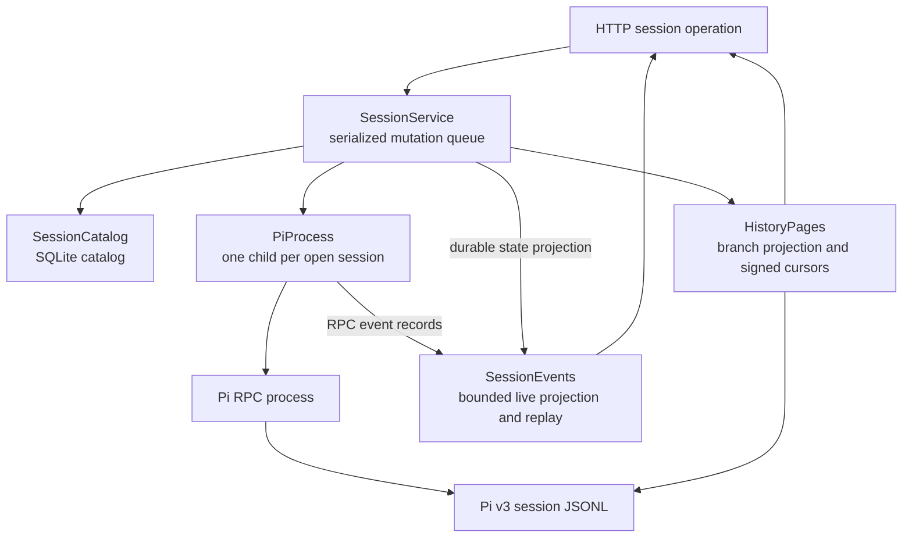
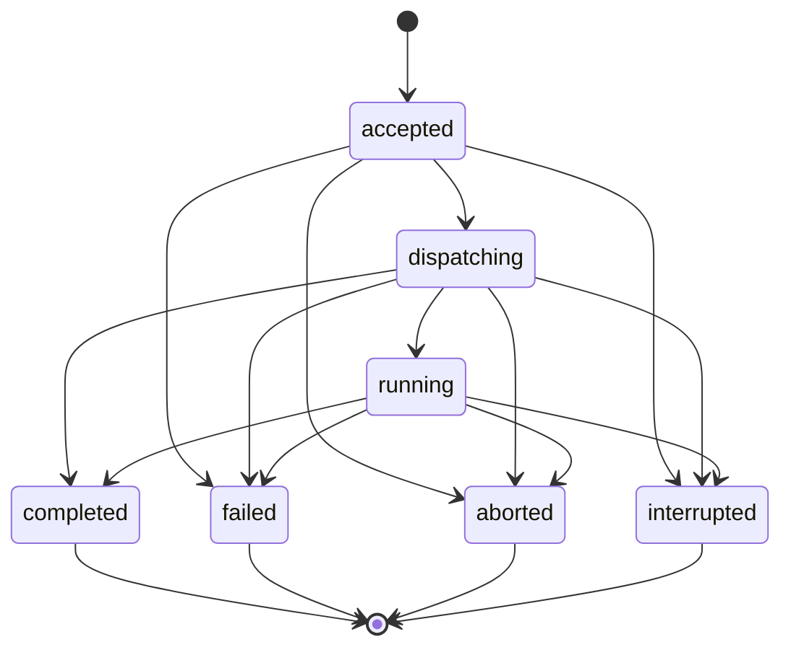

# Sessions, storage, history, and events

English | [简体中文](../i18n/zh-CN/handbook/sessions-storage.md)

Detailed prose walkthrough: [Implementation](implementation/sessions.md).

[Handbook index](README.md) · [Pi runtime boundary](runtime.md)

Session creation, Pi execution, saved history, event observation, and restart recovery span [`SessionService`](../../src/sessions/service.ts), [`SessionCatalog`](../../src/storage/catalog.ts), [`HistoryPages`](../../src/sessions/history.ts), and [`SessionEvents`](../../src/sessions/events.ts). Together they coordinate three kinds of state:

| State | Owner | Lifetime and purpose |
| --- | --- | --- |
| Session and turn metadata | `SessionCatalog` in SQLite | Durable identities, selected model metadata, turn status, cancellation intent, and native Pi entry IDs. Prompt text and images are transient request data; saved conversation entries live in Pi's native history. |
| Conversation and Pi-native entries | Pi's v3 JSONL file | The native transcript and branch tree. Dwell validates and reads it, and Pi owns updates while a runtime is open. |
| Child processes, live projections, request bodies, replay windows, and native execution observations | `SessionService`, `PiProcess`, and `SessionEvents` in memory | Active coordination for the current host process; these in-memory operations and observations reset on restart. |

## The durable catalog

[`SessionCatalog`](../../src/storage/catalog.ts) owns Dwell's SQLite file and validates both its schema and every decoded record. The current schema is version 4. All statements use Node's synchronous `DatabaseSync`; SQL values are parameterized for data writes.

### Tables and invariants

| Table | Stored values and constraints |
| --- | --- |
| `runtime_configuration` | A single optional row (`singleton = 1`) with the canonical Pi executable and optional entry point. |
| `sessions` | Dwell ID, unique creation request ID, request payload identity, canonical project directory, nullable provider/model pair, optional thinking level, Pi session ID and file, `history_expected`, durable status, timestamps, and an optional error. A `ready` row must have provider and model. |
| `turns` | Run, session, and request IDs; SHA-256 payload identity; status; cancellation flag; timestamps; optional paired error code/message; and a JSON array of native entry IDs. `(session_id, request_id)` is unique, and a partial unique index permits at most one `accepted`, `dispatching`, or `running` turn for a session. `session_id` references `sessions(id)`. |

The TypeScript validators require exact object keys for stored sessions and turns. Database decoding rejects wrong SQLite types, unsafe integers, invalid enum values, malformed entry ID JSON, non-SHA-256 turn payload identities, incomplete error pairs, invalid UUID-backed `TurnInfo`, and unknown session or turn states. A validation failure does not coerce data into a plausible record.

Session statuses are `creating`, `ready`, `failed`, and `interrupted`. Turn statuses are `accepted`, `dispatching`, `running`, `completed`, `failed`, `aborted`, and `interrupted`. The allowed turn transitions are:

Terminal turns cannot transition again. `updateTurn()` checks that request ID, payload identity, and creation time remain immutable. It checks status transitions even before SQLite constraints run. The partial index provides a second, durable guard against two active turns for one session.

`markTurnDispatching(turn, session)` is a SQLite transaction. It accepts only a `dispatching` turn and its matching session with `historyExpected: true`, updates both rows under `BEGIN IMMEDIATE`, and commits them together. If either update fails it rolls back both. The service uses this operation before writing a `prompt` command to Pi: after a crash, startup can tell that a session may have acquired transcript history even if Dwell cannot prove whether Pi accepted the prompt.

### Opening, migrations, and local file checks

`SessionCatalog.open(dataDir)` first uses `prepareDataDirectory()`, then creates `catalog.sqlite` as an owner-only file if absent. Before SQLite opens it, Dwell checks that the database is a regular, current-user-owned, single-link file with mode `0600`, using no-follow/nonblocking open flags. SQLite opens with foreign keys enabled, big integer reads, and extensions disabled. Initialization uses `DELETE` journal mode and `synchronous = FULL`.

Schema initialization is one transaction. Version 0 is accepted only when there is no user schema, then creates the current version directly. Versions 1, 2, and 3 are checked against their exact expected schema SQL before transactional migration to version 4. Version 1 first adds the turn table and active-turn index, then applies the later migrations. Version 2 becomes version 3 before version 4. Version 3 adds the nullable `thinking_level` session field. Migrations verify the resulting schema and run `PRAGMA foreign_key_check` before commit. Unsupported versions, a mismatched schema, preserved rows that violate the turn/session foreign key, or failed migration checks are rolled back and reported as an invalid/unsupported catalog; startup does not reset the file.

`prepareDataDirectory()` requires an owner-only `0700` directory. The native Pi session JSONL can keep Pi's usual 0644 mode because its containing Dwell session directory is private. The catalog's SQLite durability and Pi's JSONL durability are separate: a transaction cannot atomically commit both files.

### Catalog operations

| Method | Role |
| --- | --- |
| `configuration()`, `configure()` | Read or replace the singleton runtime path configuration. `configure()` validates exact fields and requires a nonempty executable path and, when present, nonempty entry point. Executable validation/version probing belongs to `SessionService`. |
| `list()`, `get(id)`, `findRequest(requestId)` | Read decoded session rows, ordered by creation for list; creation request IDs are globally unique. |
| `insert(session)`, `update(session)` | Validate and write a session record. `update()` requires one existing row. |
| `interruptCreating(now)` | Mark only session rows still in `creating` as interrupted after host restart. |
| `insertTurn()`, `updateTurn()` | Validate turn identity and state; updates enforce immutable request identity and allowed transitions. |
| `getTurn()`, `findTurnRequest()`, `latestTurn()`, `activeTurn()`, `listTurns()` | Read a turn by session/run, session/request, latest row admission order, active status, or all turns. |
| `markTurnDispatching()` | Atomically set the history expectation and dispatching turn. |
| `interruptTurns(now)` | Interrupt unfinished rows during host startup, preserving the stronger timestamp if the clock moves backwards. |
| `close()` | Close an open SQLite handle; repeated close is harmless. |

`interruptTurns()` sets accepted turns to `interrupted/not_dispatched` with a message saying the prompt was not sent. `dispatching` and `running` become `interrupted/outcome_unknown`: a child may have received the command or completed work before the host stopped. Terminal turns remain as they were.

## `SessionService`: host-side session ownership

[`SessionService.create()` and methods](../../src/sessions/service.ts) are the orchestration layer. It combines the catalog, Pi child processes, saved history, Dwell turn records, model discovery, event projections, and shutdown. Public entry points such as HTTP handlers call this service; they do not own Pi directly.

### Startup and mutation scheduling

`SessionService.create(options)` prepares the private data directory and opens the catalog. Before returning the service, it validates stored session paths and identities, validates all turns, marks interrupted session creation and unfinished turns, and closes the catalog if recovery validation fails. Startup does not launch Pi or replay old prompts.

The service copies its chosen child environment when created. Tests/embedders can supply a controlled environment, extension paths, deterministic clock, or internal turn checkpoint. The checkpoint is a test seam for staging accepted/dispatching/running/settled race conditions, not client input.

`#mutate()` appends operations to one promise chain and contains prior rejection so later operations can proceed. It serializes configuration changes, session creation/open/close/model changes, and turn admission. A turn's actual Pi work is launched after its durable admission and runs outside this queue; this lets a slow turn in one session coexist with operations in another session. Session-local maps and the catalog's unique partial index reserve one active turn per session.

`#read()` is separate from the mutation queue. The service tracks history/result reads and native history refreshes in one set capped at two; a public read is rejected as `history_busy` (429) when both slots are occupied. Reads also receive a host-shutdown abort signal. All saved-file scans share the lower process-wide `readSavedHistory()` budget of two active scans and eight FIFO waiters across callers; see [the read budget](runtime.md#saved-history-file-reads).

### Session creation and opening

`createSession(request)` validates a UUID request ID, absolute directory (at most 4,096 characters), paired provider/model fields, and their length limits. It hashes the originally admitted request tuple `[directory, provider, model]` before canonicalizing or touching the filesystem. Reusing the same request ID and settings returns the existing session; reusing it with different settings raises `request_conflict` (409). This means a retry can still be identified after the requested directory was removed.

For a new request the service requires a configured Pi runtime, canonicalizes the project path and requires a directory, prunes failed/exited child processes, and enforces an eight-open-runtime limit. It inserts a `creating` session row before it starts Pi. `#open()` then starts Pi and changes the row to `ready` after state checks. A Pi startup error is saved as `failed` with a generic startup error and returned as session state; invalid directories or missing Pi configuration fail before a session row is inserted.

`#open()` follows this order:

1. Reject an already-aborted request. Return the existing runtime if it is ready; report a busy conflict if it is running.
2. Prune failed or exited runtimes, enforce the eight-open-session limit, require Pi configuration, and re-resolve the stored directory. If its canonical path changed since creation, opening returns `directory_changed` and leaves the stored project path unchanged.
3. Locate the known Pi file, or discover at most one file that matches this session's Pi ID. Verify that it remains inside the owning Dwell session directory and that its v3 header identifies the expected Pi session and project.
4. If `historyExpected` is true but the saved file is missing, opening marks the error and fails with `history_unavailable` (410); the session remains tied to its expected transcript.
5. Capture a complete assistant-message identity baseline from saved history when possible. An absent or incomplete source makes the identity unknown instead of treating later messages as certainly new.
6. Start a `PiProcess` against the existing file or the stored Pi session ID, and provide provider/model only for a new session. Attach state, native-execution, and passive record observers.
7. Verify the returned session ID, selected model, and session file. For a new transcript, apply the stored thinking level if needed, except when an extension already began native work during startup. Read state again after any selection change.
8. Persist the selected model/thinking level, Pi file path, `ready` status, and history expectation; then publish the updated view.

An error after the child starts stops the process, removes observers, and removes it from the runtime map. `openSession(id)` is serialized, so concurrent opens share the one result: the first starts Pi and the next observes the ready runtime. `closeSession(id)` persists the current Pi file metadata and stops only the runtime. It rejects while a Dwell turn or running native process owns the session. Closing does not delete the durable Dwell session or its Pi transcript.

`SessionInfo` keeps three status dimensions distinct:

| Field | Source |
| --- | --- |
| `status` | Durable catalog state: `creating`, `ready`, `failed`, or `interrupted`. |
| `runtimeState` | Current process map projected to `closed`, `opening`, `ready`, `failed`, or `closing`; a running Pi child still projects as public `ready`. |
| `historyState` | `unavailable` when a persisted missing-history error is present, `available` when the catalog expects a native file, otherwise `empty`. |

The view also exposes selected provider/model/thinking level, Pi session ID, current/latest Dwell turn IDs, and the current or most recent process-local native execution summary. The turn payload hash is omitted from this public view.

### Model and context operations

`listSessionModels(id)` reads the already-open Pi process's loaded registry and coalesces concurrent reads for that runtime. It allows a ready/running runtime and rejects a closed session. If the runtime changes before the response returns, the read fails as `session_changed`. Session capability lookup validates the requested pair and returns only that model's supported image/thinking options.

Global `listAvailableModels()` coalesces one in-flight discovery. `getModelCapabilities()` keys requests by provider/model, coalesces identical requests, and permits up to two distinct checks at once. The discovery implementation lives in `server/session-discovery.ts`; session-scoped model capability reads use the active Pi session and can therefore see extension-provided models.

`setSessionModel()` is serialized and requires a durable `ready` session with no active Dwell turn. It opens Pi, checks the current session identity/model, changes model and optional thinking level, then reads state back. A known Pi `set_model` rejection for a missing model or absent API key becomes `model_unavailable` (400). An unconfirmed or malformed result closes the runtime so Pi cannot keep running with metadata Dwell failed to persist. If saving the selected state fails, the service also stops the runtime, marks the session storage-faulted, and rejects with `storage_unavailable` (503).

The native extension refresh path handles model/thinking changes made outside Dwell's `setSessionModel()`. After an observed native execution settles, one coalesced state refresh may update the catalog if the stored session selection is still exactly what it was before the refresh. If another operation changed it meanwhile, the refresh does not overwrite that newer selection. State-observation errors do not rewrite the native execution's settled outcome.

`getContext(id)` opens Pi through the mutation queue and calls `get_messages`; it returns Pi's current model context and updates stored history metadata. This is different from `getHistory(id)`, which reads the native file without opening Pi.

## Durable turn lifecycle

`submitTurn(id, request)` validates a UUID request ID, nonempty text or image content, the 8 KiB UTF-8 message limit, no leading slash command, and the exact supported image structure. The message/image order and all image bytes are included in the payload identity; text-only turns hash the message bytes. The catalog stores only that digest, not the prompt body.

Turn admission proceeds in a mutation operation:

1. Find an existing turn for this session/request ID before testing session busy. An identical payload returns the original turn with `created: false`; different payload content raises `request_conflict` (409).
2. Reject if this session already has an in-memory or durable active Dwell turn, or if its current native Pi work is running. A different session may still admit its own turn.
3. Insert a durable `accepted` row, clear the prior process-local native execution as the selected live result, reserve an `ActiveTurn` slot, publish the view, and schedule `#executeTurn()` on the next immediate turn of the event loop.
4. Return the accepted record. Execution continues under the service's session slot, independent of the caller connection.

`#executeTurn()` owns the slot until Pi settlement and all final bookkeeping complete. Its checkpoints expose deterministic test barriers at accepted, dispatching, running, and settled stages.

| Stage | Durable and runtime work |
| --- | --- |
| Accepted | Confirm the row is still active and storage is usable. If shutdown began, persist an aborted pre-dispatch result. Open or reuse the Pi runtime with cancellation linked to both host shutdown and turn abort. |
| Baseline | Require known prior history when the session already expected a transcript. For image turns, check that the selected Pi model accepts images. Read saved history and occurrence-aware assistant identities immediately before dispatch. |
| Dispatching | Atomically persist `historyExpected: true` and turn status `dispatching`. Publish state before calling Pi. This protects a possibly created native transcript if the host crashes between dispatch marking and RPC delivery. |
| Run start | Begin a bounded Dwell live projection, attach a passive observer, call `PiProcess.startRun()`, and mark the slot dispatched. For `started`, persist `running`. For `handled`, detach the Dwell event observer; a separate native execution may continue. |
| Settlement | Await `settled`, then any cancellation acknowledgement. An uncertain cancellation cleanup fails closed. A handled request enters the handled-history path; a regular result refreshes Pi's file metadata and reads saved history. |
| Final ledger write | Collect saved Pi entry IDs absent from the pre-dispatch ID set. Persist the Pi outcome (`completed`, `failed`, or `aborted`), those native IDs, timestamps, and a provider error when appropriate. Only this persisted terminal record becomes a durable terminal turn event. |
| Cleanup | For a known pre-dispatch cancellation on a session that had no prior history, restore `historyExpected: false`. Await abort cleanup, detach observer, release the active slot, end live projection, and publish the resulting state. |

`#completeHandledTurn()` reads Pi state and history without inventing a model assistant reply. It saves current model/thinking and Pi file metadata, then records only actual new native entries. If the session was already expected to have a file and that file has disappeared, completion cannot be claimed. An extension that handled a no-op can produce a completed turn with no entry IDs.

### Request identity, cancellation, and errors

The durable `TurnInfo` exposes run ID, request ID, status, cancellation intent, timestamps, an optional error, and native entry IDs. A private `payloadIdentity` hashes the original prompt identity for idempotency. `turnView()` removes that digest before returning data.

`abortTurn(id, runId)` is scoped to the current run ID. For a turn that has not reached prompt dispatch, it persists `aborted` and cancels queued history-baseline work. For a dispatched turn, it persists `cancellationRequested: true` while retaining the active status, asks Pi to abort, and waits for the eventual settlement. A successful Pi completion can win the abort race. The session slot remains reserved through abort acknowledgement and cleanup so that a late cancellation cannot land on a later run.

If Pi's abort request fails, the runtime is stopped and the outcome remains uncertain. If persisting cancellation fails, the session becomes storage-faulted and the target runtime is stopped best-effort. A storage fault blocks further durable turn operations for that session until host restart after repair. The service cannot roll back tools that already completed in Pi.

Error classification in `#executeTurn()` is conservative:

- A `prompt` `RpcCommandError` means Pi rejected the command, so the turn is `failed`.
- A failure before dispatch is `failed`, unless shutdown requested cancellation first, in which case it is `aborted`.
- A dispatched failure that is not a known prompt rejection is `interrupted` with `outcome_unknown` because Pi may have acted.
- A known service validation/readiness error retains its `SessionError` code/message in the turn row.
- There is no automatic prompt replay after failure or restart.

The catalog and Pi file are not a single transaction. If Pi settles and writes history but the final catalog update fails, saved content can remain while the turn ledger stays interrupted/unknown. A stream fault communicates failed durable bookkeeping; it does not convert live content into a durable completed turn.

`getTurn()` reads metadata only. `getTurnResult()` requires a settled turn and reads only the stored Pi entry IDs from the saved JSONL, without starting Pi. An active turn returns `turn_pending` (409). A completed turn with no native entries returns an empty result. Missing source/entries are `result_unavailable` (410); deeply nested or serialized results over 8 MiB are `result_limit` (413), and the user can use paginated history instead.

## Native execution and saved-content reconciliation

Pi extensions can start agent work without a submitted Dwell prompt or continue after an extension handled one. `PiProcess` reports a process-local native execution ID and outcome; `SessionService` projects the latest observation through `SessionInfo.nativeExecution`. Native execution does not create a `turns` row, request key, payload hash, or Dwell result endpoint.

The service associates native output with saved content only when it can prove the relationship:

1. Before a runtime starts, it captures complete assistant-message occurrence counts from saved history. Missing, malformed, or incomplete history makes identity unknown.
2. At native start, the service records a baseline from that saved history or, where a Dwell run was already being observed, from the live event accumulator. If no trustworthy baseline exists, coverage is blocked.
3. When an assistant `message_end` is observed, the live projection hashes the entire message with `savedMessageKeys()` semantics and increments occurrence counts. Identical message bodies remain separate by occurrence number. Message observations that cannot be identified block a complete coverage claim.
4. At settlement, an expected message-key delta is computed from the baseline, unless the runtime was attached after work had already started; in that case the service later derives expected keys from the saved file.
5. A later complete history read must find every expected assistant key on the saved active branch and a persisted branch leaf before `coveredNativeExecutionId` is returned. Empty, incomplete, unidentified, or branch-mismatched evidence never claims coverage.

Tool result entries are associated with the assistant message that owns their tool call ID during history projection. Tool IDs alone are scoped by their assistant-message identity so a repeated native call ID in a different run is not mistaken for the same tool. Starting a new Dwell turn clears the old native execution as the selected live result; the earlier native transcript remains in Pi history.

Native execution abort requires the current execution ID and verifies it still matches `PiProcess.activeExecution`. Repeated aborts share one promise. If Pi does not acknowledge abort, the runtime is stopped; failure to stop is surfaced as `native_abort_failed` (503). A stale or replaced execution ID is rejected instead of targeting newer work.

## Saved history and history projection

Pi's v3 session file is JSONL with a v3 session header followed by entries forming a tree through `id` and `parentId`. The low-level reader and file limits are documented in [runtime.md](runtime.md#saved-history-file-reads). [`SessionService.#history()`](../../src/sessions/service.ts) locates the expected file, confines it to the Dwell-owned session directory, and verifies header session ID, project `cwd`, and version before `HistoryPages` parses it.

### Page and cursor behavior

[`HistoryPages.read()`](../../src/sessions/history.ts) reads saved Pi history directly and returns bounded pages without storing full transcripts in SQLite. It:

1. Validates an optional cursor and reads the current saved-history snapshot or the exact byte prefix pinned by that cursor. The reader returns only complete JSONL records and flags an unterminated tail.
2. Builds an ID map and follows parent IDs backward from the persisted `leafId`, then reverses that path into conversation order. Abandoned sibling branches are omitted from the displayed path; `branchIds` preserves the IDs on the selected path for coverage checks.
3. Starts at the newest page boundary, walking toward older branch entries. The page contains at most 100 projected entries and targets at most 240 KiB, reserving space for metadata and cursor inside the shared 256 KiB response envelope. Entry projection caps each entry at 64 KiB.
4. Returns entries in conversation order with `nextCursor` pointing to the next older boundary. An append after page one does not change that page's revision; a changed, truncated, or replaced pinned prefix is rejected.

The cursor payload includes the Dwell session ID, byte count, file revision, and `before` entry boundary. Each `HistoryPages` instance creates a random 32-byte HMAC key at construction, validates it with `timingSafeEqual`, limits encoded cursor length to 1,536 characters, and checks that its session ID and numeric fields are valid. Consequently cursors are process-local: host restart invalidates them, and clients must reload the newest page.

`SessionService.getHistory()` returns one of three states:

| History status | Condition |
| --- | --- |
| `empty` | No saved file is expected and no first dispatched turn is still waiting to materialize one. |
| `pending` | A first turn is active, its dispatch has not materialized history, and the read found no file yet. |
| `available` | A validated Pi file exists and the requested page was read. |

If the catalog already expects history but the file is gone and there is no pending first dispatch, the service reports `history_unavailable` (410), distinguishing a missing transcript from an empty conversation. The response includes the native revision/leaf, incomplete-tail flag, current/latest turn IDs, and a `coveredTurnId` only if every native entry ID for the latest terminal turn lies on the active branch. That marker proves entry persistence on the selected branch; turn outcome and page completeness remain separate fields.

`getHistoryImage()` rereads the current saved history and serves an image only when the entry is a message on the active branch, the requested index selects a valid saved image block, the base64 is canonical, the decoded size is at most 5 MiB, and the MIME type is PNG, JPEG, WebP, or GIF. Image bytes are not embedded in the page response.

### Projected history content

Projection turns heterogeneous native Pi entries into `HistoryEntry` rows with typed blocks and explicit truncation/unsupported markers. It displays user and assistant text, visible thinking, tool calls/results, supported images by index, Pi-native Bash execution command/output, visible custom messages, branch summaries, compaction summaries, context-edit notices, and labels. System messages, hidden custom messages, custom state entries, usage entries, and ordinary model/thinking/session-name metadata are excluded. Unknown entry types/roles become a diagnostic with an unsupported marker instead of leaking the unrecognized serialized object.

Each entry is budgeted by serialized JSON size, including escaping and metadata, to 64 KiB. Content arrays project at most 64 blocks. Tool input traversal is limited to depth 32 and 10,000 values; beyond that a bounded placeholder is shown and marked truncated. Long strings and metadata are shortened by encoded byte budget without splitting Unicode code points. The page entry budget counts JSON-escaped UTF-8 bytes, not character count.

Project-instruction previews are derived from Pi's saved system context, not by reopening the project directory or rereading local files. The projection follows `sections.project_context` on system message entries and compaction system messages; a `null` state clears the active sources and a string replaces them. It recognizes `<project_instructions path="…">` blocks, returns at most 32 sources, caps each content preview at 16 KiB, and caps the serialized source list at 96 KiB. Path text is bounded too. Omitted or shortened material is marked by `contextSourcesTruncated` or the per-source `truncated` field.

The direct turn-result endpoint returns raw Pi entries selected by native IDs; it is not the same as this display projection. It has an 8 MiB response limit and does not copy provider text or binary image data into the turn catalog.

## Live events and bounded replay

[`SessionEvents`](../../src/sessions/events.ts) stores process-local views, live projections, subscribers, and replay frames. It never owns the Pi process. `SessionService.subscribeEvents()` reads durable session/turn metadata and asks `connect()` to reconcile it with the current cache before returning an initial snapshot or replay.

### Cursor and subscription sequence

An event cursor is `<session UUID>:<epoch UUID>:<sequence>`. The session check prevents cross-session replay. An epoch is generated when a cached stream is created; host restart or cache eviction creates another epoch. Sequence values increase only for accepted replayable frames.

`connect()` validates session and turn relationships, checks host and session subscriber caps, reconciles the current durable view, computes initial frames, and registers the subscriber synchronously. Thus the snapshot cursor and subscription share a sequence boundary: an event cannot fall between snapshot creation and subscriber registration.

| Cursor condition | Initial response |
| --- | --- |
| No cursor | Current snapshot. |
| Valid same-epoch cursor with all later events retained and a small enough batch | Missing replay events in order; an empty batch means the subscriber is current. |
| Malformed cursor or cursor for a different session | `InvalidCursorError`, translated by the service to `invalid_cursor` (400). |
| Old epoch, stale sequence, sequence ahead of the stream, or replay too large for one connection | `resync` frame followed by a new snapshot. |

Snapshots include bounded session metadata, active and latest turn summaries, and one current assistant message plus tool progress. They do not carry the native transcript; use the separate history API. A newly accepted turn clears the prior run's live projection before dispatch.

### Frame projection

The stream sends Dwell-shaped events: `session.updated`, `turn.updated`, `message.started`, `message.delta`, `message.finished`, `tool.started`, `tool.updated`, `tool.finished`, `projection.limited`, `projection.error`, and `stream.error`. Pi records are first validated/projected; raw `assistantMessageEvent`, provider records, and arbitrary Pi payloads are not forwarded as frame payloads.

For message observation, only assistant messages are accumulated. `message_start` seeds supported text and thinking blocks. Subsequent `text_*` and `thinking_*` updates are keyed by content index; the accumulator compares cumulative partial content against existing text to avoid repeating seeded prefixes. An authoritative cumulative partial can still preserve a legitimate repeated prefix delta. `message_end` replaces the accumulator with the complete supported content, records a whole-message identity if possible, correlates tool-call IDs to that assistant identity, and emits the final message.

One live assistant message contains ordered blocks. Text block ranges refer to the concatenated visible message text; thinking blocks retain their text separately. Incremental text deltas contain only newly appended text, while thinking deltas stay in the typed block field. Message identity counts distinguish identical full messages by occurrence number, preserving separate messages that happen to have equal content.

Tool progress accepts a nonempty tool call ID up to 1,024 UTF-8 bytes and a nonempty tool name. Calls are correlated by owner assistant identity plus the raw Pi call ID, or by current live message identity when no owner is known. The stream retains up to eight tools. Input/output JSON strings are bounded to 8 KiB, tool-name strings to 512 encoded JSON bytes, and complete live message text to a 56 KiB escaped-JSON budget. Supported message content has at most 64 blocks.

Shared validators in [`src/shared/events.ts`](../../src/shared/events.ts) enforce a 64 KiB serialized business-event envelope and a 224 KiB snapshot envelope. The hub retains up to 1,000 events or 1 MiB per session and rejects an initial replay batch over the 224 KiB conservative connection budget. Each limit class emits `projection.limited` once per live projection; projection errors emit at most one `projection.error` for that live state. A snapshot that exceeds its envelope retries with no live message/tools and `truncated: true`; it fails only if the metadata-only fallback is also invalid.

Defaults are 64 cached session streams, eight subscribers per session, and 32 subscribers across the host. Cache eviction chooses the least recently used stream with no active run and no subscribers; active work and connected readers pin their stream. A hub with no evictable stream refuses a new connection with `stream_unavailable` (503). Subscriber exceptions or rejected listener promises remove only that subscriber. They never stop Pi or change a turn outcome.

`publishSession()` and `publishTurn()` are best-effort projections after catalog changes. The first durable view seeds a cache; later changes emit update frames. A persisted terminal turn update is emitted only after its catalog write. `SessionService.#publishState()` sends a bounded `stream.error` when it cannot rebuild the durable view, and storage faults use `storage_unavailable`; neither path creates a false terminal turn event.

The hub does not implement socket buffering or heartbeats; the HTTP event-stream adapter owns transport queuing, heartbeat timing, and disconnect cleanup. A disconnected observer has no effect on runtime ownership or cancellation.

## Concurrency and recovery boundaries

| Boundary | Rule |
| --- | --- |
| Mutating service operations | One `SessionService` promise chain serializes admission, model/session changes, open, and close. A failed operation does not poison later queue operations. |
| Turn execution | Each session has one in-memory active slot and SQLite enforces one active durable turn. Execution runs outside the global mutation chain so unrelated sessions can progress. |
| History reads | Public service reads are capped at two in flight; the process-wide history scanner has two active permits plus eight queued waiters. A queued cancellation is removed before it scans. |
| Event observers | Receive projections only. A callback error detaches that subscriber; it does not cancel the child, abort a turn, or block another subscriber. |
| Durable writes vs Pi transcript | SQLite transitions are atomic within SQLite. Pi JSONL writes are independent. A crash can preserve transcript content while leaving Dwell's turn status interrupted/unknown. |

On shutdown, the service closes admission, persists cancellation and aborts work that has not been dispatched, then aborts dispatched work. It stops all Pi children concurrently using stdin EOF followed by bounded TERM/KILL escalation, waits for owned turn slots to finish cleanup, removes runtime observers, closes event streams, drains admitted history reads and discovery/refresh promises, and finally closes SQLite. Failure to persist runtime metadata is reported after cleanup; no unfinished prompt is replayed by a later `SessionService.create()`.

### Error and evidence distinctions

| Condition | Service behavior |
| --- | --- |
| Pi not configured or runtime cannot start | `runtime_unavailable` (503); a failed new session is also saved with status `failed`. |
| Session has active Dwell or native work | `session_busy` (409); a second turn is never sent. |
| A known required transcript is missing | `history_unavailable` (410); no empty replacement session is started. |
| A history cursor points at a changed file prefix | `history_changed` (409); reload the newest page. |
| A Pi file is malformed or identifies another session/project | `invalid_history` (409); the source is not rewritten. |
| History exceeds file/record/entry bounds | `history_limit` (413); the read does not expand limits. |
| A history scan queue is full | `history_busy` (429); retry after active reads drain. |
| A turn is still active | `turn_pending` (409); turn results are available only after settlement. |
| A required terminal ledger write fails | The session is storage-faulted, further durable work is blocked, observers receive a storage fault, and the runtime is stopped where needed. |
| A dispatched request loses transport or host before outcome is known | The durable turn is interrupted/unknown; Pi history may still contain useful saved output. |

`coveredTurnId` and `coveredNativeExecutionId` are persistence/reconciliation markers. They prove that known native entry/message identities are present on the selected saved branch. They do not change a failed or interrupted execution into a successful outcome, and they do not mean the current page contains the entire transcript.

## Test map

| Behavior | Tests |
| --- | --- |
| Session creation, canonical paths, idempotent retries, concurrent opens, runtime selection, and missing-history protection | [`tests/sessions.test.ts`](../../tests/sessions.test.ts) |
| Durable turn admission, request-key deduplication, busy protection, cancellation before/during dispatch, completion/abort races, and no replay after shutdown | [`tests/turns.test.ts`](../../tests/turns.test.ts) |
| Catalog constraints, immutable identities, active-turn uniqueness, dispatch transaction rollback, and restart interruption fields | [`tests/turn-catalog.test.ts`](../../tests/turn-catalog.test.ts) |
| Final ledger and cancellation persistence failure recovery | [`tests/turn-recovery.test.ts`](../../tests/turn-recovery.test.ts) |
| Native executions, startup and post-prompt follow-ups, scoped abort, saved-history reconciliation, and native model/thinking refresh | [`tests/native-executions.test.ts`](../../tests/native-executions.test.ts) |
| Saved history/result across host restart, direct Pi handoff, missing/corrupt source, and completion race | [`tests/history-service.test.ts`](../../tests/history-service.test.ts) |
| History scan cancellation, queue removal, and shutdown drain | [`tests/history-cancellation.test.ts`](../../tests/history-cancellation.test.ts) |
| Per-session saved-entry projection, signed pagination cursors, entry/page budgets, and image references | [`tests/history.test.ts`](../../tests/history.test.ts) and [`tests/history-context.test.ts`](../../tests/history-context.test.ts) |
| Session event ownership, late subscribers, live-to-saved convergence, failed observers, storage faults, and process loss | [`tests/session-events.test.ts`](../../tests/session-events.test.ts) |
| Event sequence boundaries, cursor replay/resync, message identity, metadata/content bounds, tool projection, and subscriber/cache limits | [`tests/events.test.ts`](../../tests/events.test.ts) |
| SQLite privacy checks, exact schema validation, migrations, rollback, corrupt/future version rejection, and creation recovery | [`tests/catalog.test.ts`](../../tests/catalog.test.ts) |
| Session model discovery against Pi's loaded registry and model capability validation | [`tests/session-models.test.ts`](../../tests/session-models.test.ts) and [`tests/session-discovery.test.ts`](../../tests/session-discovery.test.ts) |
| HTTP adapters for sessions, turns, saved history, and event streams: authentication, request bounds, client disconnects, and socket behavior | [`tests/sessions-http.test.ts`](../../tests/sessions-http.test.ts), [`tests/turns-http.test.ts`](../../tests/turns-http.test.ts), [`tests/history-http.test.ts`](../../tests/history-http.test.ts), and [`tests/events-http.test.ts`](../../tests/events-http.test.ts) |
| Runtime RPC/process and native JSONL edge cases | [Runtime test map](runtime.md#runtime-test-map) |
