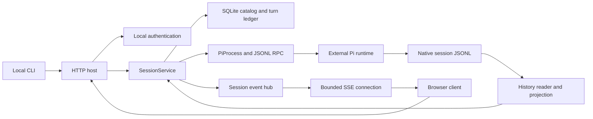
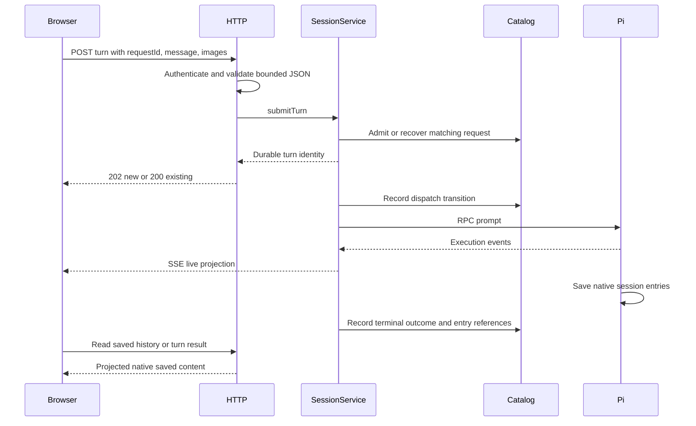

# System and execution flows

English | [简体中文](../i18n/zh-CN/handbook/system.md)

Detailed prose walkthrough: [Implementation](implementation/overview.md).

[Handbook index](README.md)

## The ownership model

A browser is a controller and observer of a host-owned Pi session. Leaving the page does not stop the host's work. Closing a session or stopping the service does affect execution.

| State | Owner | Lifetime |
| --- | --- | --- |
| Browser pairing and revocation | `LocalAuth` | Hashed browser credentials are persisted; pairing codes are in memory |
| Runtime executable configuration | `SessionCatalog` | SQLite |
| Dwell session ID, Pi session ID, working directory, model and lifecycle | `SessionCatalog`, coordinated by `SessionService` | SQLite plus live runtime state |
| Request identity and turn outcome | Turn ledger | SQLite; a retry can find its existing request |
| Actual model/tool execution | Pi child process | Until completion, cancellation, failure, or host shutdown |
| Conversation branch and saved content | Pi | Native JSONL |
| Live deltas and reconnect replay | Session event hub | Bounded memory; not the transcript |
| Composer text, image drafts, selected tab, disclosures | Browser | Browser state; draft attachments are not a saved transcript |

Dwell uses RPC to preserve Pi's tools, model behavior, and session format. Pi remains responsible for the agent loop; Dwell adds process supervision, request admission, persistent outcome tracking, history projection, and client coordination.

## Startup: claim the listener before touching state

1. [The entry point](../../src/cli.ts) delegates arguments to `runCli`; errors become a concise stderr message and nonzero exit status.
2. A foreground `serve` command dynamically imports the host; service commands delegate to the platform service manager.
3. [`startHost`](../../src/server/http.ts) builds its status identity and binds `127.0.0.1:8787`. Internal tests can request another port; CLI flags cannot.
4. Only after binding does the host prepare its private data directory, load optional HTTPS-origin configuration, open authentication state, and create `SessionService`.
5. Session creation opens the catalog and reconciles interrupted state. Persisted records are not a promise that an old Pi child is still alive.
6. Requests during initialization or shutdown receive an unavailable response. A successful authenticated status response identifies protocol, mode, process, and instance.

Binding first ensures a second host cannot modify state while another owns the port. Development uses a separate data directory but the same public port, so production and development are mutually exclusive on that listener.

## Pairing a browser

The local CLI reads an owner-only bearer credential and requests a short-lived pairing code. The browser creates its own binding key and submits it with that code. `LocalAuth` serializes redemption, stores hashes of a fresh session token and the binding key, and consumes the code only after storage succeeds.

The response places the session token in an HttpOnly cookie. Subsequent browser API requests also carry the binding key. Mutations additionally require the exact origin and `X-Dwell-Request: 1`. This makes possession of the ambient cookie alone insufficient for a browser on a different local origin.

See [HTTP and authentication](http-auth.md) for expiration, limits, origin selection, and revocation behavior.

## Creating and reopening a session

The browser selects a directory on the **host**, not a directory on the client device. The browser sends a request ID and directory; model selection happens afterward in the composer. API clients can additionally supply a provider/model pair at creation. The service validates the request, creates durable identity, and starts a supervised Pi runtime in that directory.

A new session can use Pi's configured default model. A transcript-backed reopen resumes Pi's native file and adopts its effective model/thinking state. That matters when a session was used directly in Pi between Dwell runs. Access to a native session is sequential; two independent writers are not coordinated by the catalog.

The catalog records lifecycle outcomes so a failed or interrupted creation remains distinguishable from a ready session. Reloading the browser does not implicitly reopen every closed session.

## Sending one message

The HTTP acknowledgment and the model's completion are different events. Request IDs make retrying the same payload idempotent at the admission boundary. Reusing a request ID with different content is a conflict. A browser transport failure can occur after admission; inspect the request or retry using the same identity.

The ledger stores execution identity and outcome; Pi's saved entries supply result content. `dispatching` distinguishes durable intent from work known to be running. External tool side effects cannot be committed atomically with SQLite.

An extension may handle submitted input without producing an assistant reply. Extension-initiated execution can also happen outside a Dwell turn. The implementation assigns these native executions identities separate from durable request IDs.

## Live output, saved history, and reconnect

SSE provides ordered live state and bounded replay. A reconnect cursor can resume retained events; an expired or incompatible cursor requires resynchronization. A new stream snapshot reflects current state; saved conversation content is read through history.

Saved history follows Pi's active branch. During execution, live items may already have saved counterparts. Native message fingerprints, occurrence counts, and scoped tool identities allow the client to display each item once while preserving repeated identical messages that are actually distinct. Saved coverage must be proved before live content is discarded.

The browser uses keyed DOM reconciliation and animation-frame batching. This preserves compatible disclosure state, focus, selection, and image callbacks while updating the stream. Browser drafts remain client state and are not persisted on the server.

## Stop, close, disconnect, and shutdown

| Action | Effect |
| --- | --- |
| Browser disconnect or page close | Observation stops; host execution can continue |
| Stop active turn | Requests cancellation of the identified turn |
| Stop native execution | Cancels only the identified native execution |
| Close session | Stops/releases its runtime; catalog and native saved conversation remain |
| Reopen session | Starts a runtime with the stored native session |
| Stop Dwell host | Closes streams, drains admitted work, shuts down sessions and authentication writes |

The HTTP host keeps its listener through shutdown bookkeeping, rejects new work, closes connections, waits for admitted handlers, shuts down `SessionService`, drains serialized authentication writes, and finally releases the listener. Shutdown calls share one promise.

After a crash, recovery marks unfinished durable work interrupted and does not replay it automatically. Already executed tools may have effects even when a final reply was not saved. Reopening history can show saved evidence; it cannot roll back those effects.

## Navigating the source

[CLI and services](cli-service.md) explains the process envelope. [HTTP](http-auth.md) explains admission. [Sessions/storage](sessions-storage.md) owns coordination. [Runtime](runtime.md) explains Pi and native history. [Web](web-client.md) explains the client. [Contracts](contracts.md) connects all boundaries through explicit runtime validation.
