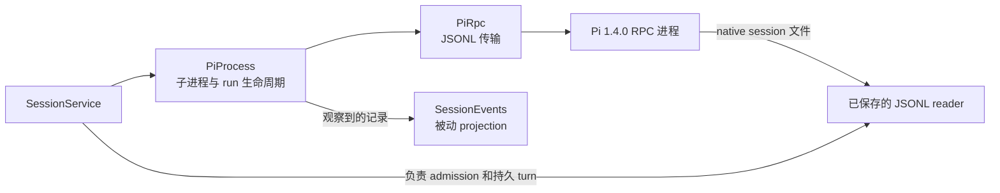

# Pi runtime 边界

[English](../../../handbook/runtime.md) | 简体中文

详细文字解释：[Implementation](implementation/runtime.md).

[手册索引](README.md) · [Session 所有权、存储、history 与 events](sessions-storage.md)

Dwell 以 RPC 子进程运行配置好的 Pi 1.4.0 executable，发送 JSON Lines 命令，验证所依赖的记录，并观察 Pi events。Pi 仍负责 agent 执行、providers、model 行为、extensions、native resources 和自身的 session 格式。

## Ownership map

`PiProcess` 在 Pi session 打开期间负责子进程和该 Pi session。Dwell observer 从不拥有执行权。`SessionService` 决定哪个 Dwell session 持有 runtime，持久化 session 和 turn metadata，并决定何时可以启动或停止子进程；详见 [sessions-storage.md](sessions-storage.md)。已保存的 history 从 Pi 的 JSONL 文件读取，不需要让 Pi 打开 runtime；详见 [history adapter](sessions-storage.md#saved-history-and-history-projection)。

## Pi 版本专属 contract

`package.json` 和 `package-lock.json` 将 `@earendil-works/pi-coding-agent` 锁定为 **1.4.0**。Dwell 不导入 Pi SDK，也不把 Pi 类型复制到自己的 runtime。它使用自己的 `Record<string, unknown>` wire 表示发送 Pi `RpcCommand` union 的一个小子集，然后验证 Dwell 所需的每个 response 字段。

命令子集如下：

| Pi RPC record | Dwell 用途 |
| --- | --- |
| `get_state` | 启动就绪检查、当前 session identity/file/model/thinking state，以及 extension 后的 metadata refresh。 |
| `get_available_models` | 当前 session 已加载的 model registry 和 image capability 检查。 |
| `get_available_thinking_levels` | 针对 model 发现 thinking level。 |
| `set_model`, `set_thinking_level` | 修改一个 idle session，再读回 state 确认结果。 |
| `get_messages`, `get_entries` | 当前 Pi context，以及内部操作使用的 live session entries。 |
| `prompt`, `abort` | 提交 text/image prompt，并请求取消。 |
| `extension_ui_response` | 回答或取消受支持的 extension dialog；Pi 不会对这条 record 返回普通 command response。 |

Pi 的 `prompt` response 报告是否接受以及 disposition。`agent_settled`、message events、tool events 和 extension UI requests 会分别到达。Dwell 在发送 `prompt` 前先安装 run state，使得 events 即使早于 acceptance response 到达也能安全处理。`handled` disposition 表示该 prompt 没有启动标准 model run；extension 仍可能执行独立 work。

## `PiProcess`：一个子进程与一个 session

[`PiProcess`、`PiOptions` 和 runtime state](../../../../src/runtime/pi-process.ts) 构成公开的 runtime 边界。

### 启动与就绪

`PiProcess.start(options)` 会先验证参数，再创建子进程：

1. `sessionId` 必须是有效 UUID，且不能与 `resumeFile` 同时提供。executable、project directory、session directory、可选 Node entry point 和 extension paths 都必须是绝对路径。
2. Provider 和 model 必须同时提供；provider 最多 200 个字符，model 最多 300 个字符。两者也可以都省略，以使用 Pi 保存的默认值。
3. RPC request 与 shutdown deadlines 必须是 1 到 60,000 ms 的安全整数。默认 request timeout 为 15 秒；每个 shutdown escalation interval 为 2 秒。
4. Project 会通过 `realpath` 规范化并且必须是目录。Dwell 会验证 session directory。Resume path 必须是绝对路径、指向现存文件，并位于已验证的 data directory 下。
5. `verifyPiConfiguration()` 会解析 executable 和可选 entry point，在配置好的 child environment 中运行 `--version`，并且只接受完全匹配的支持版本。执行失败会规范化为 configuration error；版本不同的错误不会暴露无限输出。
6. Dwell 以 `0700` 权限创建 session directory，然后使用 `shell: false` 启动 executable，并通过 piped stdin/stdout/stderr 通信。

核心参数是 `--mode rpc --session-dir <path>`。新 session 还可以收到 `--session-id`；已存在的 session 则使用 `--session <file>`。只有打开新文件时才传入显式 model flags，因为 resume 时已保存的 transcript 是权威来源。Extensions 以重复的 `--extension` flags 传入。`resourcePolicy: "isolated"` 时，Dwell 会添加 Pi 的六个 `--no-*` flags，分别禁用 extensions、skills、prompt templates、themes、MCP 和 context files。Hosted sessions 不使用此策略，使用 Pi 的 native resource loading；isolated probes 则会启用它。

启动后会等待 `get_state`，再检查 Pi 是否选中了 model、是否重新打开请求的 file 或保留请求的 ID，以及新 session 是否选中了任何显式指定的 model。Session 若以 streaming、compacting 或有 pending messages 的状态打开会被拒绝，除非启动期间观察到了 extension execution。启动失败时会先停止子进程，再返回错误。

### Runtime state

`RuntimeState` 是进程 state，不是 `SessionService` 暴露的持久 session status：

| State | 此 class 中的含义 |
| --- | --- |
| `starting` | 子进程已创建，正在进行就绪检查。 |
| `ready` | Pi 处于 idle，Dwell 可以开始操作。 |
| `running` | Dwell run 或已观察到的 native Pi execution 正占用 session 的 active slot。 |
| `stopping` | Dwell 已关闭 RPC input，正在等待子进程退出。 |
| `exited` | 子进程在有序停止后已关闭。 |
| `failed` | 启动、传输、协议验证或意外子进程退出使该进程不可继续使用。 |

订阅时 observer 会立即收到当前 state，之后也会收到状态变化。State callback 的错误会被吞掉。意外的 child close 会将 state 改为 `failed`；请求停止后的 close 则把 `stopping` 改为 `exited`。如果子进程在 settlement 前停止，runtime 会中断 live Dwell run，或发出结果为 `interrupted` 的 native-execution event。

`SessionService` 将 `starting` 映射为公开的 `opening`，将 `stopping` 映射为 `closing`，将 `ready` 和 `running` 映射为公开的 `ready`，将 `failed` 映射为 `failed`，其他 state 映射为 `closed`。Runtime projection 与 catalog 中的 `creating`/`ready`/`failed`/`interrupted` status 分开表示。

### Session 检查与 model 控件

`getState()` 会验证所需 booleans、安全的非负 message counts、thinking-level enum，以及可选且非空的 `{ provider, id }` model。State 无效时会让 RPC connection 失败，因为 Dwell 无法基于不可用的 session snapshot 安全继续。

`getEntries()` 接受由 records 组成的 array；每个 record 都必须有唯一且非空的 ID、非空 entry type，以及为 null 或非空的 `parentId`；其 `leafId` 必须为 null 或指向某个 entry。已保存文件的 reader 在处理持久 JSONL 时会验证 parent 顺序和 file identity。`getMessages()` 会检查 Pi 返回的是 array，且每条 message 都有 string role，同时为内部 callers 保留 Pi message objects。

`getAvailableModels()` 要求进程处于 ready 或 running，并委托给 [`parsePiSessionModels()`](../../../../src/runtime/pi-models.ts)。Parser 最多接受 10,000 个唯一 provider/model pairs，验证公开 registry fields，并且只返回 provider、model ID、image support 和支持的 thinking levels。它不会 projection headers、credentials 或其他 model-registry fields。超过 1 MiB 的序列化 projection 会被拒绝。

Parser 将 `null` thinking-level mapping 视作 disabled。`reasoning: false` 只会产生 `off`；支持 reasoning 的 models 使用已安装 registry 的 mapping，而 `xhigh`/`max` 必须有显式 mapping。Extension-provided models 仅暴露 Pi registry mapping 中的 levels。

`getAvailableThinkingLevels()` 会验证一个非空、无重复且最多七项的已知 levels 列表。`setModel()` 和 `setThinkingLevel()` 要求 runtime idle 且为 `ready`，并会在 mutation 后验证 Pi state。`setModel()` 还会检查返回的 provider 和 model 是否与请求完全一致；malformed 或不同的 selection 会让 runtime 失败。`supportsImages()` 会同时读取当前 state 和 model registry，检查所选 model 的 `input` list，不会切换 model。

保存 configuration 前也会调用 `verifyPiConfiguration()`。它会规范化 executable 和 entry-point paths 后再返回。

## `startRun()`：接受与 settlement 是两个阶段

`startRun(message, images)` 返回两个 promises：

- `accepted` 在 Pi 确认 prompt disposition 后解析为 `"started"` 或 `"handled"`。Pi command rejection 会通过 `RpcCommandError` reject 此 promise。
- `settled` 只有在 Pi 的 event lifecycle 建立 outcome 后才会解析为 `RunResult`。传输失败或 child loss 会使它 reject，因为执行结果可能未知。

发送 `prompt` 前，该方法会验证 runtime idle、UTF-8 prompt 不超过 1 MiB、request 中有 text 或至少一张有效 image，并且 image content 通过 Dwell 的 shared runtime validator。然后安装 `Run` 并把 state 设为 `running`；这个顺序让早到的 events 可以安全处理。两个 promises 的 rejection 都会在内部被观察到，因此 caller 只 await 其中一个也不会导致 unhandled rejection。

`Run` state 会记录 prompt disposition、agent run 是否开始或 settlement、native follow-up 是否开始、最新 assistant error/abort signal，以及两个 promises 的 continuations。`#onRecord()` 会先解释 Pi records，再把它们转发给 listeners：

| Pi event | Dwell state 更新 |
| --- | --- |
| `agent_start` | 若没有 Dwell run，则启动 native execution；否则标记 Dwell agent 已开始。如果它在 Dwell agent settlement 后、prompt response 前到达，则将 run ownership 转交给 native execution。 |
| assistant 的 `message_end` | 读取 `stopReason`；`error` 时记录 provider error text，`aborted` 时将当前 attempt 标为 aborted。后续 assistant message 会清除之前的 attempt error，使 Pi 的 retry/follow-up 行为可以正常 settlement。 |
| `agent_settled` | 要求 `aborted` 为 boolean。普通 Dwell prompt 会记录结果，并在 Pi 报告 `disposition: "started"` 后才结束；native run 则发布 native settlement。没有对应 run 的 settlement 不会造成问题。 |
| `extension_ui_request` | 验证并保存支持的 dialog request，供之后回复或等待 timeout。 |

如果 settlement 早于 prompt response 到达，结果会保留到 disposition 到达后。如果 Pi 报告 `handled`，`startRun()` 会把 Dwell run 解析为 `handled`；与其重叠或在其后开始的 extension execution 会拿到独立 execution ID 和 native lifecycle。Native execution 没有 Dwell request ID、request key 或 durable turn row。

`run(message)` 是便利形式：启动、await acceptance，然后返回 settlement。它不支持 images；image input 请使用 `startRun()`。`abort()` 请求 Pi abort 当前 `running` 进程，并等待 Pi acknowledgement。它本身不会推断最终结果：`agent_settled` 才是 outcome 的来源。Session 级 cancellation 和 storage persistence 见 [turn lifecycle](sessions-storage.md#durable-turn-lifecycle)。

### Native extension work

Extensions 可以在处理 prompt 后启动异步 work，也可以在 Pi 进程 idle 时启动 work。`PiProcess` 使用 `NativeRun`、`executionId` 和 `NativeExecutionEvent` 表示它：

1. 在 Dwell run 之外收到 `agent_start` 时，会创建 UUID 并发布 `{ type: "started" }`。
2. 后续 `agent_settled` 会根据 assistant message stop reason 和 abort event 发布 `completed`、`failed` 或 `aborted`。
3. Settlement 前 child loss 会发布 `interrupted`，并附上有长度限制的错误 message。
4. 新 subscriber 会收到 active native start event，或在有可用记录时收到最近一次 settled event。

Native records 只存在于这个 `PiProcess` 和 service 的内存 session view 中。它们描述观察到的 Pi work，而不是 Dwell request。它们的 saved-history reconciliation 和 scoped abort 行为见 [sessions-storage.md](sessions-storage.md#native-execution-and-saved-content-reconciliation)。

### Extension UI dialogs

只有 `confirm`、`select`、`input` 和 `editor` 会成为 pending dialogs。每个都需要 ID 和 title；confirmation 需要 message，selection 需要 string options。重复 ID、同时超过 32 个 dialogs、以及非正数或非有限 Pi timeout 都会作为 malformed RPC 被拒绝。生效 deadline 是 Pi timeout 和配置的 RPC request timeout 中较短的那个；Pi 未提供 deadline 时则使用 request timeout。

`respondToUi()` 只接受与 pending method 对应的 response shape，或 `{ cancelled: true }`，并将 text responses 限制在 1 MiB。未知、超时或已经回答的 IDs 会被拒绝。Notifications、status lines、widgets 和其他 extension UI records 仍会送达 observers，但此方法不会把它们当作 interactive Dwell dialogs 处理。

Subscription 默认是 interactive。移除最后一个 interactive subscriber 会取消 pending dialogs；passive observers 仍可继续接收 records，而不会让 prompt 一直等待。Dialog cancellation 是 best-effort，不会终止 Pi child。

## `PiRpc`：JSON Lines、correlation 与传输失败

[`PiRpc`](../../../../src/runtime/pi-rpc.ts) 通过 child 的 stdout 和 stdin 读写 Pi RPC 子集。UTF-8 `StringDecoder` 会保留被分片的多字节字符。Reader 只按 LF 分割，并接受紧邻 LF 前的 CR；Unicode line separators 不会被视作 record 边界。Record 必须解析为带 string `type` 的非 array object。

Command requests 会收到 `dwell-1`、`dwell-2` 等 IDs。最多可有 32 个 requests pending。Responses 必须是 `type: "response"`，并且匹配一个 pending ID 和其 command。`success: true` 时使用 `data` 解析；`success: false` 且 `error` 为 string 时，只将该 request 以 `RpcCommandError` reject。Malformed envelopes、不匹配的 responses、invalid JSON、过大的 records、stream/write errors 或 request timeout 都会让 RPC connection 失败，并 reject 所有 pending requests。如果 prompt 可能已经到达 Pi，timeout message 会明确说明执行 outcome 未知。

Writes 会串行执行，并等待 stream 的 write callback 后再发送下一行，即使遇到 backpressure 也是如此。单条编码后的 line 上限为 8 MiB，queued writes 上限为 16 MiB。单条输入 record 上限为 8 MiB。Stdout end 时若有不完整尾部 record，connection 会失败；若正好结束于完整 record 边界，则不会失败。`PiRpc.close()` 会 reject pending work，但不负责 child shutdown；`PiProcess` 负责 stdin EOF 和 signal escalation。

Command timeout 或传输失败后不会自动 retry。尤其是 retry prompt 可能会重复执行 work。Session service 会持久化保守的 interrupted/unknown turn result；详见 [restart recovery](sessions-storage.md#concurrency-and-recovery-boundaries)。

## 其他 runtime helpers

### Stable assistant-message identities

[`message-identity.ts`](../../../../src/runtime/message-identity.ts) 从完整 assistant message object 创建 identity。它会递归排序 object keys，保留 array 顺序，将结果 JSON-serialize 后用 SHA-256 hash。Key 后附 occurrence number（`digest:1`、`digest:2`……），因此内容完全相同的 assistant messages 仍会分别识别。遍历深度超过 64 或 message 无法表示时，不会产生 key，而不是因此抑制 content。当 map 已有 100,000 个不同 digests 后，不再记录新的 digest。

`savedMessageKeys()` 只对嵌套 role 为 `assistant` 的已保存 `message` entries 应用同样的 key 规则。Service 和 event projection 使用这些含 occurrence 的 identities，将完整的已保存 message 与 stream output 匹配，或判断 native extension content 是否已被 saved branch 覆盖。仅比较 text 或 tool-call IDs 不足以确定 identity。

### Saved-history file reads

[`pi-history.ts`](../../../../src/runtime/pi-history.ts) 将 Pi v3 JSONL 作为有界 snapshot 读取；它不会要求 Pi process 打开、重写或 resume 该文件。它会验证文件是当前 Unix user 所有的 regular file、只有一个 hard link、使用 `O_NOFOLLOW`，比较 descriptor 与 path identity，并在读取前后检查 file metadata；扫描时若 metadata 改变，还会重新读取所选 bytes。Pi 通常使用的 0644 JSONL mode 可以接受，因为其 parent session directory 是 private 的。

Reader 将单次扫描限制为 128 MiB、单条 JSONL record 限制为 8 MiB、最多 100,000 个 entries；native entry ID/type/parent ID 最多 1,024 个字符，timestamp 最多 100 个字符。它只接受 v3 header，且 session ID 和 `cwd` 必须匹配调用方预期；timestamps 必须可解析并符合规范，每个 entry ID 必须唯一，parent IDs 必须已在文件前面出现。完整的空白行会被忽略。完整但 malformed 的 record 会失败；未终止的最后一条 record 会被排除，并报告为 `incompleteTail`。

读取结果包含原始 `PiEntry[]`、最后一个持久 entry ID、完整 bytes 数、包含 device/inode identity 和文件 bytes 的 SHA-256 revision，以及 incomplete-tail flag。Caller 可用 `{ bytes, revision }` 固定一个完整 byte prefix。Append 不会使该 prefix 失效；edit、替换、截断或非 record 边界的 prefix 会产生 `history_changed`。`HistoryReadError` 的 status/code pairs 为 `invalid_history` (409)、`history_changed` (409)、`history_unavailable` (410)、`history_limit` (413) 和 `history_busy` (429)。

[`pi-history-budget.ts`](../../../../src/runtime/pi-history-budget.ts) 为所有 `readSavedHistory()` callers 提供进程级 FIFO read budget：两个 scans 可以并行，另有八个等待名额，更多调用会失败。取消会移除排队中的 read；已获得许可的 file read 不会在扫描途中中断。Shutdown 专用的 `cancelQueuedOnly` mode 允许 shutdown 前已通过 admission 的 public read 使用当时空闲的 permit，但 shutdown 开始后不允许它加入等待队列。

## Runtime 测试图

| 关注点 | 测试 |
| --- | --- |
| 真实的 Pi 1.4.0 pinned process、resource loading/trust、native settings、model/thinking selection、session reopen、run/abort、native extension work、UI dialogs、observers 与 process exit | [`tests/runtime.test.ts`](../../../../tests/runtime.test.ts) |
| Malformed/过大的/截断的 RPC output、response correlation、early settlement、command rejection 与不确定的 transport error、deadlines、shutdown escalation、private stderr bounds、pending-request 数量和 prompt-size 拒绝 | [`tests/runtime-failure.test.ts`](../../../../tests/runtime-failure.test.ts) |
| 公开 model metadata projection，以及 malformed/重复/过量的 registry results | [`tests/pi-models.test.ts`](../../../../tests/pi-models.test.ts) |
| Native JSONL identity、完整与部分 records、pinned revisions、变化中的文件、limits、symlinks、hard links 和不可用 history | [`tests/pi-history.test.ts`](../../../../tests/pi-history.test.ts) |
| 全局 read 并发、队列容量、公平性和排队取消 | [`tests/pi-history-budget.test.ts`](../../../../tests/pi-history-budget.test.ts) 与 [`tests/history-cancellation.test.ts`](../../../../tests/history-cancellation.test.ts) |

Session 级集成、live event projection、native coverage 和 saved-history 展示见 [sessions-storage.md](sessions-storage.md#test-map)。
