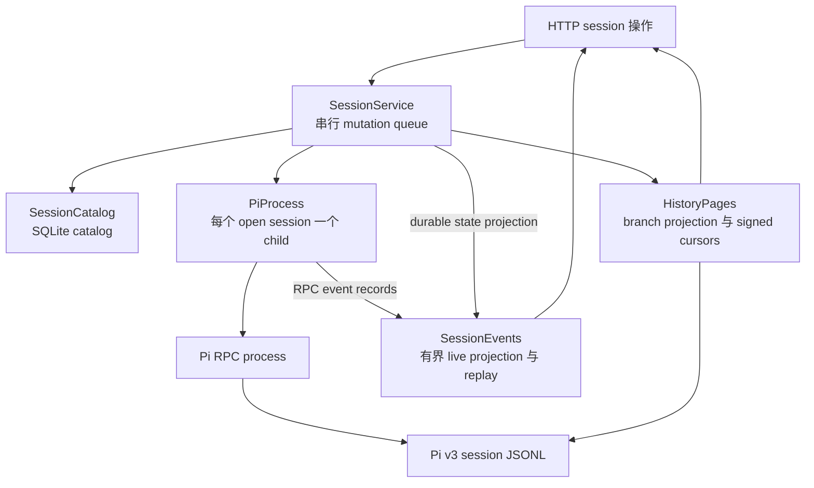
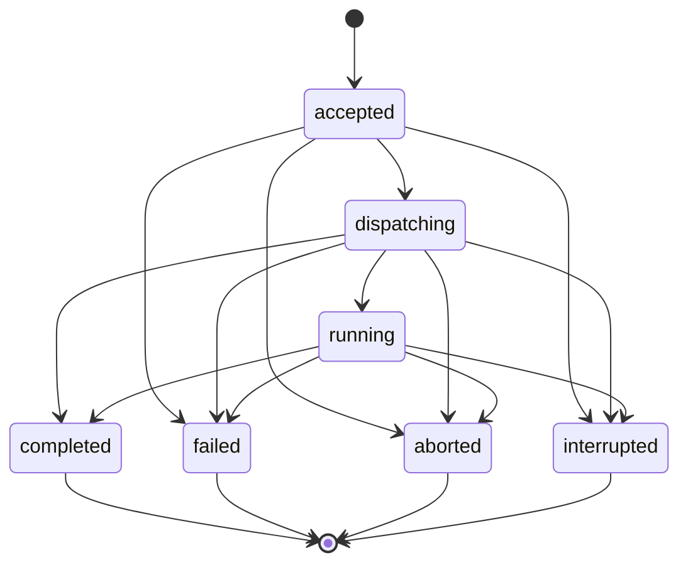

# Sessions、存储、history 与 events

[English](../../../handbook/sessions-storage.md) | 简体中文

详细文字解释：[Implementation](implementation/sessions.md).

[手册索引](README.md) · [Pi runtime 边界](runtime.md)

Session 创建、Pi 执行、已保存 history、event observation 和 restart recovery 涉及 [`SessionService`](../../../../src/sessions/service.ts)、[`SessionCatalog`](../../../../src/storage/catalog.ts)、[`HistoryPages`](../../../../src/sessions/history.ts) 和 [`SessionEvents`](../../../../src/sessions/events.ts)。它们共同协调三种 state：

| State | Owner | Lifetime 与用途 |
| --- | --- | --- |
| Session 与 turn metadata | SQLite 中的 `SessionCatalog` | 持久 identity、所选 model metadata、turn status、cancellation intent 和 native Pi entry IDs。Prompt text 和 images 是临时 request data；已保存的 conversation entries 位于 Pi native history 中。 |
| Conversation 与 Pi-native entries | Pi 的 v3 JSONL 文件 | Native transcript 和 branch tree。Dwell 会验证并读取它；runtime 打开时则由 Pi 负责更新。 |
| Child processes、live projections、request bodies、replay windows 和 native execution observations | 内存中的 `SessionService`、`PiProcess` 和 `SessionEvents` | 当前 host process 的活动协调状态；restart 后这些内存 operations 与 observations 会重置。 |

## 持久 catalog

[`SessionCatalog`](../../../../src/storage/catalog.ts) 负责 Dwell 的 SQLite 文件，并验证其 schema 和每条解码后的 record。当前 schema 版本为 4。所有 statements 都使用 Node 的同步 `DatabaseSync`；写入数据时，SQL values 使用 parameterization。

### Tables 与 invariants

| Table | 存储值与约束 |
| --- | --- |
| `runtime_configuration` | 一个可选的单行记录（`singleton = 1`），存储规范化的 Pi executable 和可选 entry point。 |
| `sessions` | Dwell ID、唯一的创建 request ID、request payload identity、规范化的 project directory、可为 null 的 provider/model pair、可选 thinking level、Pi session ID 与 file、`history_expected`、持久 status、timestamps 和可选 error。`ready` row 必须有 provider 和 model。 |
| `turns` | Run、session、request IDs；SHA-256 payload identity；status；cancellation flag；timestamps；成对出现的可选 error code/message；以及 native entry IDs 的 JSON array。`(session_id, request_id)` 唯一；partial unique index 确保每个 session 最多有一个处于 `accepted`、`dispatching` 或 `running` 的 turn。`session_id` references `sessions(id)`。 |

TypeScript validators 要求已存 sessions 和 turns 的 object keys 完全匹配。Database decoding 会拒绝错误的 SQLite types、不安全 integers、无效 enum values、malformed entry-ID JSON、非 SHA-256 的 turn payload identities、不完整的 error pairs、UUID 格式不正确的 `TurnInfo`，以及未知 session/turn states。Validation 失败时不会把数据强转为看似合理的 record。

Session statuses 为 `creating`、`ready`、`failed` 和 `interrupted`。Turn statuses 为 `accepted`、`dispatching`、`running`、`completed`、`failed`、`aborted` 和 `interrupted`。允许的 turn transitions 如下：

Terminal turns 不可再次 transition。`updateTurn()` 会检查 request ID、payload identity 和 creation time 是否保持 immutable。它会在 SQLite constraints 执行前检查 status transitions。Partial index 则提供第二道持久保护，避免一个 session 出现两个 active turns。

`markTurnDispatching(turn, session)` 是一个 SQLite transaction。它只接受 status 为 `dispatching` 的 turn，以及与之匹配且 `historyExpected: true` 的 session；然后在 `BEGIN IMMEDIATE` 下更新两行并一起 commit。若任一 update 失败，则会同时 rollback。Service 在向 Pi 写入 `prompt` command 前调用此方法：crash 后，startup 能知道该 session 可能已经产生 transcript，即使 Dwell 无法确认 Pi 是否接受了 prompt。

### 打开、迁移与本地文件检查

`SessionCatalog.open(dataDir)` 首先调用 `prepareDataDirectory()`，然后在 `catalog.sqlite` 不存在时以 owner-only 权限创建。SQLite 打开前，Dwell 会使用 no-follow/nonblocking open flags 检查数据库是否为当前 user 所有、regular、只有一个 hard link 且 mode 为 `0600`。SQLite 打开时会启用 foreign keys 和 big integer reads，并禁用 extensions。初始化使用 `DELETE` journal mode 和 `synchronous = FULL`。

Schema 初始化使用一个 transaction。只有不存在 user schema 时才接受 version 0，并直接创建当前 version。Versions 1、2 和 3 必须先与各自准确的预期 schema SQL 匹配，再以 transaction 迁移到 version 4。Version 1 先添加 turn table 和 active-turn index，再应用后续迁移。Version 2 先变为 version 3，再升级至 version 4。Version 3 会给 session 增加 nullable 的 `thinking_level` field。迁移会验证最终 schema，并在 commit 前运行 `PRAGMA foreign_key_check`。不支持的 version、不匹配的 schema、违反 turn/session foreign key 的保留 rows，或迁移检查失败都会 rollback 并报告 invalid/unsupported catalog；startup 不会重置文件。

`prepareDataDirectory()` 要求 directory 为 owner-only `0700`。Pi native session JSONL 可以保留 Pi 常见的 0644 mode，因为其所在的 Dwell session directory 是 private 的。Catalog 的 SQLite durability 和 Pi 的 JSONL durability 相互独立：一个 transaction 无法原子地 commit 这两个文件。

### Catalog operations

Public methods 提供以下 catalog operations：

| Method | 作用 |
| --- | --- |
| `configuration()`, `configure()` | 读取或替换 singleton runtime path configuration。`configure()` 验证准确 fields，并要求 executable path 非空；若提供 entry point，也必须非空。Executable validation/version probing 由 `SessionService` 负责。 |
| `list()`, `get(id)`, `findRequest(requestId)` | 读取已解码的 session rows；list 按 creation 排序，creation request IDs 全局唯一。 |
| `insert(session)`, `update(session)` | 验证并写入 session record。`update()` 要求目标 row 已存在。 |
| `interruptCreating(now)` | Host restart 后只将仍处于 `creating` 的 session rows 标为 interrupted。 |
| `insertTurn()`, `updateTurn()` | 验证 turn identity 和 state；update 会强制 immutable request identity 和允许的 transitions。 |
| `getTurn()`, `findTurnRequest()`, `latestTurn()`, `activeTurn()`, `listTurns()` | 按 session/run、session/request、latest row admission order、active status 或所有 turns 读取 turn。 |
| `markTurnDispatching()` | 原子地设置 history expectation 和 dispatching turn。 |
| `interruptTurns(now)` | Host startup 时中断未完成 rows；若时钟倒退则保留更大的 timestamp。 |
| `close()` | 关闭打开的 SQLite handle；重复 close 无害。 |

`interruptTurns()` 将 accepted turns 设为 `interrupted/not_dispatched`，并写入 prompt 尚未发送的 message。`dispatching` 和 `running` 则变为 `interrupted/outcome_unknown`：子进程可能已收到 command，也可能在 host 停止前完成 work。Terminal turns 保持原样。

## `SessionService`：host 侧 session 所有权

[`SessionService.create()` 与 methods](../../../../src/sessions/service.ts) 是 orchestration layer。它组合 catalog、Pi child processes、saved history、Dwell turn records、model discovery、event projections 和 shutdown。Public entry points（例如 HTTP handlers）会调用此 service；它们不会直接拥有 Pi。

### Startup 与 mutation scheduling

`SessionService.create(options)` 会准备 private data directory 并打开 catalog。返回 service 前，它会验证已存 session paths 和 identities、验证所有 turns、标记中断的 session 创建与未完成 turns；若 recovery validation 失败，则关闭 catalog。Startup 不会启动 Pi，也不会重放旧 prompts。

Service 创建时会复制选定的 child environment。Tests/embedders 可以提供受控 environment、extension paths、deterministic clock 或内部 turn checkpoint。Checkpoint 是用于安排 accepted/dispatching/running/settled race conditions 的 test seam，不是 client input。

`#mutate()` 将 operations 追加到一条 promise chain，并捕获之前 operation 的 rejection，使后续 operations 仍能继续。它串行化 configuration changes、session create/open/close/model changes 和 turn admission。Turn 的实际 Pi work 在 durable admission 后启动，并在此 queue 之外运行；这样一个 session 中的慢 turn 不会阻塞其他 session 的 operations。Session-local maps 与 catalog 的 unique partial index 会为每个 session 保留一个 active turn。

`#read()` 独立于 mutation queue。Service 将 history/result reads 和 native-history refreshes 放在同一个集合中跟踪，最多允许两个同时执行；两个 slots 都被占用时，public read 会以 `history_busy` (429) 被拒绝。Reads 还会收到 host-shutdown abort signal。所有 saved-file scans 共用更底层、进程级的 `readSavedHistory()` budget：跨 callers 最多两个 active scans，另有八个 FIFO waiters；详见 [read budget](runtime.md#saved-history-file-reads)。

### Session 创建与打开

`createSession(request)` 会验证 UUID request ID、绝对 directory（最多 4,096 个字符）、成对提供的 provider/model fields，以及它们的长度限制。它会在 canonicalize 路径或触碰文件系统前，对最初通过 admission 的 request tuple `[directory, provider, model]` 做 hash。相同 request ID 与 settings 会返回现有 session；相同 ID 配不同 settings 会产生 `request_conflict` (409)。因此，即使请求中的 directory 已被删除，retry 仍能识别为同一个 request。

新 request 要求已配置 Pi runtime；Service 会规范化 project path 并要求它是 directory，清理 failed/exited child processes，并强制最多八个 open runtimes。它会先插入 `creating` session row，再启动 Pi。之后 `#open()` 启动 Pi，并在 state 检查完成后将 row 改为 `ready`。Pi startup error 会以通用 startup error 保存为 `failed` 并作为 session state 返回；invalid directories 或缺少 Pi configuration 会在插入 session row 前失败。

`#open()` 按以下顺序执行：

1. 若 request 已 abort，则拒绝。Runtime 已 ready 时返回现有 runtime；若仍 running，则报告 busy conflict。
2. 清理 failed/exited runtimes，执行八个 open sessions 的限制，要求已配置 Pi，并重新解析 stored directory。若 canonical directory 自创建后发生变化，则返回 `directory_changed`，不会静默地将 project 移到别处。
3. 定位已知 Pi file，或最多发现一个与此 session 的 Pi ID 匹配的 file。验证它仍位于所属 Dwell session directory 中，并且 v3 header 标识了预期 Pi session 和 project。
4. 如果 `historyExpected` 为 true，但 saved file 不存在，则记录 error 并以 `history_unavailable` (410) 失败。Dwell 不会用新的空 Pi session 替代预期存在却缺失的 transcript。
5. 若可行，从 saved history 获取完整 assistant-message identity baseline。Source 不存在或不完整时，identity 会标为未知，而不会把后续 messages 当成确定的新内容。
6. 针对现有 file 或 stored Pi session ID 启动 `PiProcess`；只有新 session 才提供 provider/model。添加 state、native-execution 和 passive record observers。
7. 验证返回的 session ID、selected model 和 session file。对于新 transcript，必要时应用已存 thinking level；但若 extension 已在启动期间开始 native work，则不应用。任何 selection change 后再次读取 state。
8. 持久化 selected model/thinking level、Pi file path、`ready` status 和 history expectation；然后发布更新后的 view。

Child 启动后若出错，会停止进程、移除 observers，并将其从 runtime map 移除。`openSession(id)` 是串行的，因此并发 opens 会共享一个结果：第一个启动 Pi，之后的调用看到 ready runtime。`closeSession(id)` 会持久化当前 Pi file metadata 并且只停止 runtime。只要 Dwell turn 或 running native process 持有 session，它就会拒绝 close。关闭不会删除 durable Dwell session 或 Pi transcript。

`SessionInfo` 将三个 status 维度分开：

| Field | 来源 |
| --- | --- |
| `status` | Durable catalog state：`creating`、`ready`、`failed` 或 `interrupted`。 |
| `runtimeState` | 当前 process map 映射为 `closed`、`opening`、`ready`、`failed` 或 `closing`；running 的 Pi child 对外仍映射成 `ready`。 |
| `historyState` | 存在已持久化的 missing-history error 时为 `unavailable`；catalog 预期有 native file 时为 `available`；否则为 `empty`。 |

View 还会暴露 selected provider/model/thinking level、Pi session ID、当前/最新 Dwell turn IDs，以及当前或最近一次 process-local native execution summary。Turn payload hash 不会出现在这个 public view 中。

### Model 与 context operations

`listSessionModels(id)` 从已打开的 Pi process 读取其 loaded registry，并合并对该 runtime 的并发 reads。它接受 ready/running runtime，拒绝 closed session。如果 response 返回前 runtime 已变化，则以 `session_changed` 失败。Session capability lookup 会验证请求的 pair，只返回该 model 支持的 image/thinking options。

全局 `listAvailableModels()` 会合并一个进行中的 discovery。`getModelCapabilities()` 按 provider/model 建 key，合并相同 requests，同时最多允许两个不同的 checks。Discovery 实现在 `server/session-discovery.ts`；Session-scoped model capability reads 使用 active Pi session，因此可以看到 extension-provided models。

`setSessionModel()` 是串行操作，要求 durable session 为 `ready` 且没有 active Dwell turn。它会打开 Pi，检查当前 session identity/model，修改 model 和可选的 thinking level，然后读回 state。Pi 通过 `set_model` 明确拒绝不存在的 model 或缺少 API key 时，会映射为 `model_unavailable` (400)。若结果未确认或 malformed，则关闭 runtime，避免 Pi 继续使用 Dwell 无法持久化的 metadata。如果保存 selected state 失败，service 同样会停止 runtime、将 session 标记为 storage-faulted，并以 `storage_unavailable` (503) reject。

Native extension refresh path 会处理在 Dwell 的 `setSessionModel()` 之外发生的 model/thinking changes。观察到 native execution settlement 后，一次合并的 state refresh 可能会更新 catalog，但前提是 refresh 前存储的 session selection 仍完全相同。若此时另一个 operation 已改变它，refresh 不会覆盖较新的 selection。State-observation errors 不会改写 native execution 已 settled 的 outcome。

`getContext(id)` 通过 mutation queue 打开 Pi 并调用 `get_messages`；它返回 Pi 当前的 model context 并更新已存 history metadata。这与 `getHistory(id)` 不同，后者读取 native file 时不会打开 Pi。

## Durable turn lifecycle

`submitTurn(id, request)` 会验证 UUID request ID、非空 text 或 image content、8 KiB UTF-8 message limit、不以 slash command 开头，以及准确的受支持 image structure。Message/image 顺序和全部 image bytes 都纳入 payload identity；只有 text 的 turns 则对 message bytes 做 hash。Catalog 只存储 digest，不保存 prompt body。

Turn admission 在 mutation operation 中执行：

1. 在检查 session 是否 busy 前，先按本 session/request ID 查找已有 turn。Payload 完全相同则返回原 turn，`created: false`；content 不同则产生 `request_conflict` (409)。
2. 若本 session 已有内存或 durable active Dwell turn，或当前 native Pi work 正在 running，则拒绝。其他 session 仍可 admission 自己的 turn。
3. 插入 durable `accepted` row，将上一次 process-local native execution 从 selected live result 中清除，预留一个 `ActiveTurn` slot，发布 view，并安排 `#executeTurn()` 在 event loop 下一次 immediate turn 执行。
4. 返回 accepted record。Execution 随后由 service 的 session slot 持续管理，与 caller connection 分离。

`#executeTurn()` 会一直拥有该 slot，直到 Pi settlement 和所有 final bookkeeping 完成。其 checkpoints 在 accepted、dispatching、running 和 settled 阶段提供 deterministic test barriers。

| Stage | Durable 和 runtime work |
| --- | --- |
| Accepted | 确认 row 仍 active 且 storage 可用。若 shutdown 已开始，则持久化 aborted pre-dispatch result。打开或复用 Pi runtime，并将 cancellation 同时关联 host shutdown 和 turn abort。 |
| Baseline | Session 已预期存在 transcript 时，要求此前 history 可识别。Image turns 要检查所选 Pi model 是否接受 images。在 dispatch 前读取 saved history 和带 occurrence 的 assistant identities。 |
| Dispatching | 原子持久化 `historyExpected: true` 和 turn status `dispatching`。调用 Pi 前先发布 state。若 host 在 dispatch marker 与 RPC delivery 之间 crash，这可以保护可能已创建的 native transcript。 |
| Run start | 启动有界 Dwell live projection，附加 passive observer，调用 `PiProcess.startRun()`，并标记 slot 已 dispatched。若结果为 `started`，持久化 `running`。若为 `handled`，移除 Dwell event observer；独立 native execution 可能继续。 |
| Settlement | Await `settled`，之后再等待任何 cancellation acknowledgement。不确定的 cancellation cleanup 会 fail closed。Handled request 进入 handled-history path；普通结果则 refresh Pi file metadata 并读取 saved history。 |
| Final ledger write | 收集 pre-dispatch ID 集合中没有的 saved Pi entry IDs。持久化 Pi outcome（`completed`、`failed` 或 `aborted`）、这些 native IDs、timestamps，以及适用时的 provider error。只有这个已持久化的 terminal record 才会成为 durable terminal turn event。 |
| Cleanup | 若已知 cancellation 发生在 pre-dispatch 阶段，且 session 之前没有 history，则恢复 `historyExpected: false`。等待 abort cleanup、detach observer、释放 active slot、结束 live projection，并发布最终 state。 |

`#completeHandledTurn()` 会读取 Pi state 和 history，不会虚构 model assistant reply。它保存当前 model/thinking 和 Pi file metadata，然后只记录实际新增的 native entries。如果 session 之前已预期存在 file，但 file 已消失，就不能声称完成。若 extension 处理的是 no-op，则可以得到没有 entry IDs 的 completed turn。

### Request identity、cancellation 与 errors

Durable `TurnInfo` 暴露 run ID、request ID、status、cancellation intent、timestamps、可选 error 和 native entry IDs。Private `payloadIdentity` 会对最初的 prompt identity 做 hash，用于 idempotency。`turnView()` 会在返回数据前移除该 digest。

`abortTurn(id, runId)` 只作用于当前 run ID。Turn 尚未到 prompt dispatch 阶段时，它会持久化 `aborted` 并取消排队中的 history-baseline work。对已经 dispatched 的 turn，它会持久化 `cancellationRequested: true`，同时保留 active status，然后请求 Pi abort 并等待最终 settlement。Abort race 中 Pi 成功完成也可能先于取消。Session slot 会一直保留到 abort acknowledgement 和 cleanup 完成，避免延迟到达的 cancellation 落到后续 run 上。

若 Pi abort request 失败，runtime 会停止，outcome 保持不确定。若持久化 cancellation 失败，则 session 会成为 storage-faulted，target runtime 会 best-effort 停止。直到 host 在 repair 后 restart，此 session 的 storage fault 才会解除并恢复 durable turn operations。Pi 中已完成的 tools 无法回滚。

`#executeTurn()` 对 errors 的分类采取保守原则：

- `prompt` 的 `RpcCommandError` 表示 Pi 拒绝了 command，因此 turn 为 `failed`。
- Dispatch 前失败为 `failed`；但若 shutdown 先请求了 cancellation，则为 `aborted`。
- Dispatch 后若失败且不是已知 prompt rejection，则为 `interrupted` 并带 `outcome_unknown`，因为 Pi 可能已采取行动。
- 已知的 service validation/readiness error 会将其 `SessionError` code/message 保留在 turn row 中。
- 失败或 restart 后都不会自动重放 prompt。

Catalog 和 Pi file 不属于同一个 transaction。如果 Pi 已 settlement 并写入 history，但 final catalog update 失败，则 saved content 可能仍存在，而 turn ledger 仍为 interrupted/unknown。Stream fault 表示 durable bookkeeping 失败；它不会把 live content 变成 durable completed turn。

`getTurn()` 只读取 metadata。`getTurnResult()` 要求 turn 已 settled，并且只从 saved JSONL 读取已存的 Pi entry IDs，不启动 Pi。Active turn 会返回 `turn_pending` (409)。没有 native entries 的 completed turn 返回空 result。Source/entries 缺失时为 `result_unavailable` (410)；结果嵌套过深或序列化后超过 8 MiB 时为 `result_limit` (413)，此时可以改用 paginated history。

## Native execution 与 saved-content reconciliation

Pi extensions 可以在没有 Dwell prompt submission 时启动 agent work，也可以在 extension 已 handle prompt 后继续 work。`PiProcess` 会报告 process-local native execution ID 和 outcome；`SessionService` 通过 `SessionInfo.nativeExecution` projection 最新观察结果。Native execution 不会创建 `turns` row、request key、payload hash 或 Dwell result endpoint。

Service 只在能够证明关系时，才会将 native output 关联到 saved content：

1. Runtime 启动前，会从 saved history 捕获完整的 assistant-message occurrence counts。History 缺失、malformed 或不完整时，identity 会变为未知。
2. Native start 时，service 会从 saved history 建立 baseline；如果当时已有被观察的 Dwell run，则可以改用 live event accumulator 中的 baseline。若 baseline 不可信，则无法声明 coverage。
3. 观察到 assistant `message_end` 时，live projection 会按 `savedMessageKeys()` 语义对整条 message 做 hash，并递增 occurrence counts。内容相同的 messages 仍按 occurrence 分开。无法识别的 message observations 会阻止完整 coverage 声明。
4. Settlement 时，会从 baseline 计算预期的 message-key delta；如果 runtime 是在 work 开始后才 attach，则 service 之后会从 saved file 推导预期 keys。
5. 后续的完整 history read 必须在 saved active branch 中找到每个预期 assistant key，并且有已持久化的 branch leaf，才会返回 `coveredNativeExecutionId`。空、不完整、无法识别或 branch 不匹配的证据都不会声称 coverage。

在 history projection 过程中，Tool result entries 会关联到拥有其 tool call ID 的 assistant message。Tool IDs 必须限定在其 assistant-message identity 中，因此另一个 run 重复使用相同 native call ID 不会被误认为同一个 tool。开始新的 Dwell turn 会清除已选中的旧 native execution live result；较早的 native transcript 仍留在 Pi history 中。

Native execution abort 要求提供当前 execution ID，并验证它仍与 `PiProcess.activeExecution` 匹配。重复 abort 会共享一个 promise。若 Pi 没有确认 abort，则会停止 runtime；停止失败会以 `native_abort_failed` (503) 报告。Stale 或已替换的 execution ID 会被拒绝，不会误操作较新的 work。

## Saved history 与 history projection

Pi 的 v3 session file 是 JSONL：先有 v3 session header，之后 entries 通过 `id` 和 `parentId` 形成 tree。底层 reader 和 file limits 见 [runtime.md](runtime.md#saved-history-file-reads)。[`SessionService.#history()`](../../../../src/sessions/service.ts) 会定位预期 file、确保它位于 Dwell-owned session directory 内，并在 `HistoryPages` 解析前验证 header session ID、project `cwd` 和 version。

### Page 与 cursor 行为

[`HistoryPages.read()`](../../../../src/sessions/history.ts) 直接读取 saved Pi history，返回有界 pages，不会把完整 transcript 存入 SQLite。它会：

1. 验证可选 cursor，并读取当前 saved-history snapshot 或 cursor 固定的准确 byte prefix。Reader 只返回完整 JSONL records，并标记未终止的尾部。
2. 建立 ID map，从持久化的 `leafId` 开始沿 parent IDs 反向遍历，再反转路径以得到 conversation 顺序。已放弃的 sibling branches 不显示；`branchIds` 保留选定路径上的 IDs，以便检查 coverage。
3. 从最新 page boundary 开始向较旧的 branch entries 遍历。一个 page 最多 100 个 projected entries，目标大小最多 240 KiB；在共同的 256 KiB response envelope 中为 metadata 和 cursor 留出空间。每个 entry projection 不超过 64 KiB。
4. 按 conversation 顺序返回 entries，并用 `nextCursor` 指向再旧一页的 boundary。第一页之后的 append 不会改变该页的 revision；已 pinned prefix 如果改变、截断或被替换，则会被拒绝。

Cursor payload 包含 Dwell session ID、byte count、file revision 和 `before` entry boundary。每个 `HistoryPages` instance 在创建时生成一个随机 32-byte HMAC key，使用 `timingSafeEqual` 验证，并将编码后的 cursor 限制在 1,536 个字符，同时检查 session ID 和 numeric fields 是否有效。因此 cursors 只在当前 process 有效：host restart 会使它们失效，client 必须重新加载最新 page。

`SessionService.getHistory()` 会返回三种状态之一：

| History status | Condition |
| --- | --- |
| `empty` | 不预期有 saved file，且没有仍在等待生成首个 file 的 first dispatched turn。 |
| `pending` | First turn 仍 active、dispatch 尚未生成 history，且此次 read 尚未发现 file。 |
| `available` | 存在经过验证的 Pi file，且所请求的 page 已读取。 |

如果 catalog 已预期有 history，但 file 已消失且没有 pending first dispatch，service 会报告 `history_unavailable` (410)，以此区分缺失 transcript 和空 conversation。Response 包含 native revision/leaf、incomplete-tail flag、current/latest turn IDs；只有当 latest terminal turn 的每个 native entry ID 都位于 active branch 中，才会提供 `coveredTurnId`。该 marker 证明 entries 已保存到选定 branch；turn outcome 与 page 完整性由不同字段表示。

`getHistoryImage()` 会重新读取当前 saved history。只有当 entry 是 active branch 上的 message、指定 index 选中有效的 saved image block、base64 符合 canonical 格式、解码后大小最多为 5 MiB，且 MIME type 是 PNG、JPEG、WebP 或 GIF 时，才会提供 image。Image bytes 不会嵌入 page response。

### Projected history content

Projection 会把异构的 native Pi entries 转为带 typed blocks 和明确 truncation/unsupported markers 的 `HistoryEntry` rows。它显示 user 与 assistant text、可见 thinking、tool calls/results、按 index 引用的受支持 images、Pi-native Bash execution command/output、可见 custom messages、branch summaries、compaction summaries、context-edit notices 和 labels。System messages、隐藏的 custom messages、custom state entries、usage entries，以及普通 model/thinking/session-name metadata 都会排除。未知 entry types/roles 会变为带 unsupported marker 的 diagnostic，而不是泄露无法识别的序列化 object。

每个 entry 按包含 escaping 和 metadata 的序列化 JSON 大小限制为 64 KiB。Content arrays 最多 projection 64 blocks。Tool input traversal 限制为 depth 32 和 10,000 个 values；超过后会显示有界 placeholder 并标记 truncated。长 strings 和 metadata 会按编码后的 byte budget 缩短，不会拆开 Unicode code points。Page 的 entry budget 计算 JSON-escaped UTF-8 bytes，不是字符数。

Project-instruction previews 来源于 Pi 保存的 system context，不会通过重新打开 project directory 或重读本地 files 获取。Projection 会跟踪 system message entries 和 compaction system messages 中的 `sections.project_context`；`null` state 会清除 active sources，string 会替换它们。它识别 `<project_instructions path="…">` blocks，最多返回 32 个 sources；每项 content preview 最多 16 KiB，source list 序列化后最多 96 KiB。Path text 也有长度限制。省略或缩短的内容会通过 `contextSourcesTruncated` 或每个 source 的 `truncated` field 标记。

Direct turn-result endpoint 返回按 native IDs 选出的原始 Pi entries；它不同于这里的 display projection。Response 上限为 8 MiB，不会将 provider text 或 binary image data 复制到 turn catalog。

## Live events 与有界 replay

[`SessionEvents`](../../../../src/sessions/events.ts) 在 process 内存中存储 views、live projections、subscribers 和 replay frames。它不拥有 Pi process。`SessionService.subscribeEvents()` 会读取 durable session/turn metadata，并要求 `connect()` 在返回 initial snapshot 或 replay 前与当前 cache reconciliation。

### Cursor 与 subscription sequence

Event cursor 的格式是 `<session UUID>:<epoch UUID>:<sequence>`。Session check 可阻止跨 session replay。每当创建 cached stream 时都会生成一个 epoch；host restart 或 cache eviction 会产生新 epoch。Sequence values 只会对被接受且可 replay 的 frames 递增。

`connect()` 会验证 session 和 turn 的关系，检查 host/session subscriber caps，与当前 durable view reconciliation，计算 initial frames，并同步注册 subscriber。因此 snapshot cursor 与 subscriber 共用同一个 sequence boundary：snapshot 创建与 subscriber 注册之间不会漏掉 event。

| Cursor condition | Initial response |
| --- | --- |
| 没有 cursor | 当前 snapshot。 |
| 同 epoch 的有效 cursor，所有后续 events 均被保留且 batch 足够小 | 按序返回缺少的 replay events；空 batch 表示 subscriber 已处于最新状态。 |
| Malformed cursor 或属于其他 session 的 cursor | `InvalidCursorError`；service 将其映射为 `invalid_cursor` (400)。 |
| 旧 epoch、stale sequence、sequence 超前于 stream，或 replay 对单个 connection 来说过大 | `resync` frame，随后发送新的 snapshot。 |

Snapshots 包含有界 session metadata、active/latest turn summaries，以及一条当前 assistant message 加 tool progress。它们不包含 native transcript；请使用独立的 history API。新 turn 完成 admission 时，会在 dispatch 前清除先前 run 的 live projection。

### Frame projection

Stream 会发送 Dwell 格式的 events：`session.updated`、`turn.updated`、`message.started`、`message.delta`、`message.finished`、`tool.started`、`tool.updated`、`tool.finished`、`projection.limited`、`projection.error` 和 `stream.error`。Pi records 会先验证和 projection；原始 `assistantMessageEvent`、provider records 和任意 Pi payload 不会直接作为 frame payload 转发。

对于 message observation，只会累积 assistant messages。`message_start` 会用受支持的 text 和 thinking blocks 初始化。后续 `text_*` 与 `thinking_*` updates 按 content index 编号；Accumulator 会比较 cumulative partial content 与现有 text，以避免重复加入已初始化的前缀。若 authoritative cumulative partial 本身有合法重复前缀 delta，也会保留它。`message_end` 会用完整的受支持 content 替换 accumulator；若能识别则记录整条 message identity，将 tool-call IDs 与该 assistant identity 关联，再发出 final message。

一条 live assistant message 包含有序 blocks。Text block ranges 指向拼接后的可见 message text；thinking blocks 分开保留 text。Incremental text deltas 只包含新增 text，而 thinking deltas 保留在 typed block field 中。Message identity counts 会通过 occurrence number 区分完整内容相同的 messages，从而保留内容相同但实际上不同的 messages。

Tool progress 接受最多 1,024 UTF-8 bytes 的非空 tool call ID，以及非空 tool name。Calls 按 owner assistant identity 与原始 Pi call ID 关联；如果 owner 未知，则按当前 live message identity 关联。Stream 最多保留八个 tools。Input/output JSON strings 最多 8 KiB，tool-name strings 最多 512 个编码后的 JSON bytes，完整 live message text 最多使用 56 KiB escaped-JSON budget。受支持的 message content 最多 64 blocks。

[`src/shared/events.ts`](../../../../src/shared/events.ts) 中的 shared validators 将序列化 business-event envelope 限制为 64 KiB，将 snapshot envelope 限制为 224 KiB。每个 session 的 hub 最多保留 1,000 events 或 1 MiB；若 initial replay batch 超过每条 connection 保守采用的 224 KiB budget，则拒绝它。每类 limit 在一个 live projection 中只发出一次 `projection.limited`；每个 live state 最多发出一次 `projection.error`。若 snapshot 超出 envelope，则会移除 live message/tools 并以 `truncated: true` 重试；只有 metadata-only fallback 也无效时才失败。

Defaults 为 64 条 cached session streams、每 session 八个 subscribers、整个 host 共 32 个 subscribers。Cache eviction 会选择最近最少使用且没有 active run/subscribers 的 stream；active work 和 connected readers 会固定其 stream。Hub 若没有可 eviction 的 stream，会以 `stream_unavailable` (503) 拒绝新 connection。Subscriber exception 或被 reject 的 listener promise 只会移除该 subscriber；不会停止 Pi 或改变 turn outcome。

`publishSession()` 和 `publishTurn()` 会在 catalog changes 后 best-effort projection。第一个 durable view 会初始化 cache；之后的 changes 则发出 update frames。只有 catalog write 完成后，才会发出持久化的 terminal turn update。若 `SessionService.#publishState()` 无法重建 durable view，会发送有界 `stream.error`；storage faults 则使用 `storage_unavailable`。这两条路径都不会制造虚假的 terminal turn event。

Hub 不负责 socket buffering 或 heartbeats；这些 transport queuing、heartbeat timing 和 disconnect cleanup 由 HTTP event-stream adapter 负责。Observer disconnect 不会影响 runtime ownership 或 cancellation。

## 并发与 recovery 边界

| Boundary | Rule |
| --- | --- |
| Mutating service operations | 一条 `SessionService` promise chain 会串行化 admission、model/session changes、open 和 close。某个 operation 失败不会污染后续 queue operations。 |
| Turn execution | 每个 session 有一个内存 active slot，且 SQLite 强制每个 session 只有一个 durable active turn。Execution 在全局 mutation chain 之外运行，因此其他 sessions 仍可推进。 |
| History reads | Public service reads 最多同时两个；进程级 history scanner 有两个 active permits 和八个 queued waiters。排队中的 cancellation 会在扫描开始前移除 read。 |
| Event observers | 只接收 projections。Callback error 会 detach 对应 subscriber；不会 cancel child、abort turn 或阻塞其他 subscribers。 |
| Durable writes 与 Pi transcript | SQLite transitions 在 SQLite 内原子执行。Pi JSONL writes 独立发生。Crash 可能保留 transcript content，却让 Dwell turn status 留在 interrupted/unknown。 |

Shutdown 时，service 会关闭 admission，持久化 cancellation，并先 abort 尚未 dispatched 的 work，再 abort 已 dispatched 的 work。它会通过 stdin EOF 和有界 TERM/KILL escalation 并发停止所有 Pi children；等待其拥有的 turn slots 完成 cleanup；移除 runtime observers；关闭 event streams；drain 已通过 admission 的 history read 及 discovery/refresh promises；最后关闭 SQLite。若 runtime metadata persistence 失败，错误会在 cleanup 后报告；后续的 `SessionService.create()` 不会重放未完成的 prompt。

### Error 与 evidence 的区别

| Condition | Service behavior |
| --- | --- |
| Pi 未配置或 runtime 无法启动 | `runtime_unavailable` (503)；新 session 创建失败时也会保存为 status `failed`。 |
| Session 有 active Dwell 或 native work | `session_busy` (409)；不会发送第二个 turn。 |
| 已知必需 transcript 缺失 | `history_unavailable` (410)；不会启动空的替代 session。 |
| History cursor 指向已变化的 file prefix | `history_changed` (409)；重新加载最新 page。 |
| Pi file malformed 或标识了另一个 session/project | `invalid_history` (409)；不会重写 source。 |
| History 超过 file/record/entry bounds | `history_limit` (413)；read 不会放宽 limits。 |
| History scan queue 已满 | `history_busy` (429)；等 active reads 排空后重试。 |
| Turn 仍 active | `turn_pending` (409)；只有 settlement 后才能读取 turn results。 |
| 必需的 terminal ledger write 失败 | Session 会进入 storage-faulted state，进一步的 durable work 会被阻止；observers 收到 storage fault；必要时 runtime 会停止。 |
| Dispatched request 在结果未知前丢失 transport/host | Durable turn 会变为 interrupted/unknown；Pi history 仍可能包含有用的已保存 output。 |

`coveredTurnId` 和 `coveredNativeExecutionId` 是 persistence/reconciliation markers。它们证明已知 native entry/message identities 存在于选定的 saved branch。它们不会把 failed 或 interrupted execution 变为成功，也不表示当前 page 包含完整 transcript。

## 测试图

| Behavior | Tests |
| --- | --- |
| Session 创建、canonical paths、idempotent retries、并发 opens、runtime selection 和 missing-history protection | [`tests/sessions.test.ts`](../../../../tests/sessions.test.ts) |
| Durable turn admission、request-key deduplication、busy protection、dispatch 前/期间的 cancellation、completion/abort races，以及 shutdown 后不 replay | [`tests/turns.test.ts`](../../../../tests/turns.test.ts) |
| Catalog constraints、immutable identities、active-turn uniqueness、dispatch transaction rollback 和 restart interruption fields | [`tests/turn-catalog.test.ts`](../../../../tests/turn-catalog.test.ts) |
| Final ledger 与 cancellation persistence failure recovery | [`tests/turn-recovery.test.ts`](../../../../tests/turn-recovery.test.ts) |
| Native executions、startup 与 prompt 后 follow-ups、scoped abort、saved-history reconciliation，以及 native model/thinking refresh | [`tests/native-executions.test.ts`](../../../../tests/native-executions.test.ts) |
| Host restart 后的 saved history/result、direct Pi handoff、missing/corrupt source 和 completion race | [`tests/history-service.test.ts`](../../../../tests/history-service.test.ts) |
| History scan cancellation、queue removal 和 shutdown drain | [`tests/history-cancellation.test.ts`](../../../../tests/history-cancellation.test.ts) |
| Per-session saved-entry projection、signed pagination cursors、entry/page budgets 和 image references | [`tests/history.test.ts`](../../../../tests/history.test.ts) 与 [`tests/history-context.test.ts`](../../../../tests/history-context.test.ts) |
| Session event ownership、late subscribers、live-to-saved convergence、failed observers、storage faults 和 process loss | [`tests/session-events.test.ts`](../../../../tests/session-events.test.ts) |
| Event sequence boundaries、cursor replay/resync、message identity、metadata/content bounds、tool projection 和 subscriber/cache limits | [`tests/events.test.ts`](../../../../tests/events.test.ts) |
| SQLite privacy checks、exact schema validation、migrations、rollback、corrupt/future version rejection 和 creation recovery | [`tests/catalog.test.ts`](../../../../tests/catalog.test.ts) |
| 基于 Pi loaded registry 的 session model discovery 与 model capability validation | [`tests/session-models.test.ts`](../../../../tests/session-models.test.ts) 与 [`tests/session-discovery.test.ts`](../../../../tests/session-discovery.test.ts) |
| Sessions、turns、saved history 和 event streams 的 HTTP adapters：authentication、request bounds、client disconnects 和 socket behavior | [`tests/sessions-http.test.ts`](../../../../tests/sessions-http.test.ts)、[`tests/turns-http.test.ts`](../../../../tests/turns-http.test.ts)、[`tests/history-http.test.ts`](../../../../tests/history-http.test.ts) 与 [`tests/events-http.test.ts`](../../../../tests/events-http.test.ts) |
| Runtime RPC/process 与 native JSONL edge cases | [Runtime 测试图](runtime.md#runtime-test-map) |
