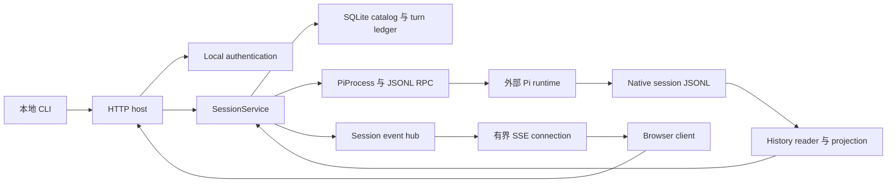
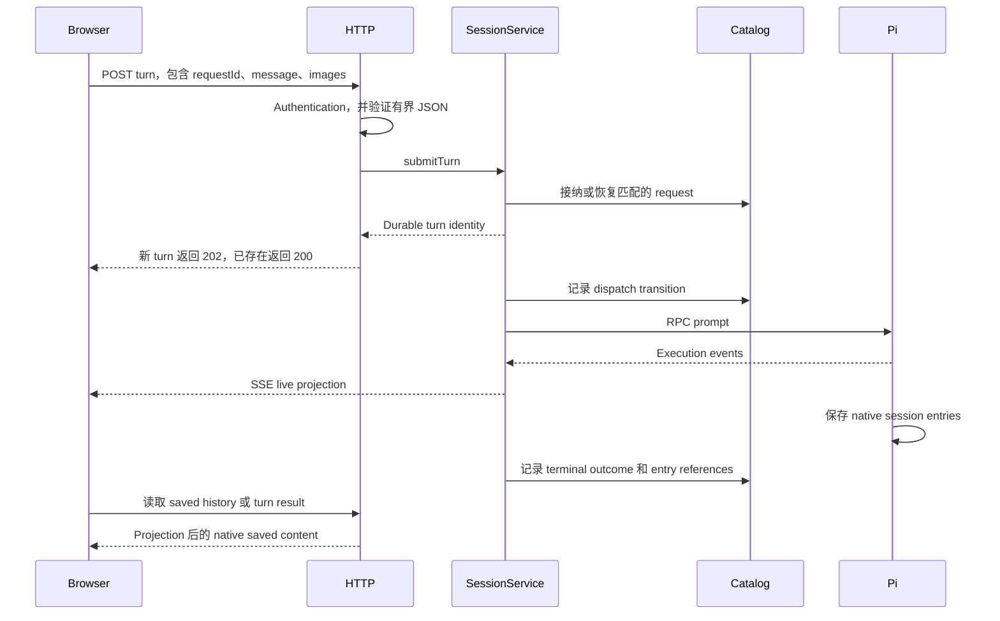

# System 与执行流程

[English](../../../handbook/system.md) | 简体中文

详细文字解释：[Implementation](implementation/overview.md).

[手册索引](README.md)

## Ownership model

Browser 是 host-owned Pi session 的 controller 和 observer。离开页面不会停止 host 上的 work。关闭 session 或停止 service 则会影响执行。

| State | Owner | Lifetime |
| --- | --- | --- |
| Browser pairing 与 revocation | `LocalAuth` | Hashed browser credentials 会持久化；pairing codes 保存在内存中 |
| Runtime executable configuration | `SessionCatalog` | SQLite |
| Dwell session ID、Pi session ID、working directory、model 与 lifecycle | `SessionCatalog`，由 `SessionService` 协调 | SQLite 加 live runtime state |
| Request identity 与 turn outcome | Turn ledger | SQLite；retry 可以找到原 request |
| 实际 model/tool execution | Pi child process | 直到完成、取消、失败或 host shutdown |
| Conversation branch 与 saved content | Pi | Native JSONL |
| Live deltas 与 reconnect replay | Session event hub | 有界内存；不是 transcript |
| Composer text、image drafts、selected tab、disclosures | Browser | Browser state；draft attachments 不属于 saved transcript |

Dwell 使用 RPC 保留 Pi 的 tools、model 行为和 session 格式。Agent loop 仍由 Pi 负责；Dwell 增加 process supervision、request admission、持久 outcome tracking、history projection 和 client coordination。

## Startup：先占用 listener，再访问 state

1. [Entry point](../../../../src/cli.ts) 将参数交给 `runCli`；errors 会变成简洁的 stderr message 和非零 exit status。
2. 前台 `serve` command 会动态 import host；service commands 委托给平台 service manager。
3. [`startHost`](../../../../src/server/http.ts) 构造 status identity，并绑定 `127.0.0.1:8787`。内部 tests 可指定其他 port；CLI flags 不行。
4. 只有绑定之后，host 才准备 private data directory、加载可选 HTTPS-origin configuration、打开 authentication state，并创建 `SessionService`。
5. Session 创建会打开 catalog 并 reconciliation interrupted state。持久化 records 不代表旧 Pi child 仍在运行。
6. 初始化或 shutdown 期间的 requests 会收到 unavailable response。成功的 authenticated status response 会标识 protocol、mode、process 和 instance。

先绑定可确保另一个 host 无法在当前 host 占用 port 时修改 state。Development 使用独立 data directory，但共用 public port，因此 production 和 development 不能同时监听该 port。

## Pairing browser

本地 CLI 读取 owner-only bearer credential 并请求短时有效的 pairing code。Browser 创建自己的 binding key，并随该 code 一起提交。`LocalAuth` 会串行处理 redemption，存储新 session token 和 binding key 的 hashes，只有 storage 成功后才消耗该 code。

Response 会把 session token 放进 HttpOnly cookie。后续 browser API requests 也会携带 binding key。Mutation 还要求精确匹配的 origin 和 `X-Dwell-Request: 1`。因此，对来自另一个本地 origin 的 browser 来说，仅持有自动附带的 cookie 并不足以通过验证。

关于 expiration、limits、origin selection 和 revocation behavior，见 [HTTP 与 authentication](http-auth.md)。

## 创建并重新打开 session

Browser 选择的是 **host 上的** directory，不是 client device 上的 directory。Browser 发送 request ID 和 directory；model selection 稍后在 composer 中进行。API clients 也可以在创建时提供 provider/model pair。Service 会验证 request、创建 durable identity，并在该 directory 中启动受监督的 Pi runtime。

新 session 可以使用 Pi 配置的默认 model。基于 transcript 的 reopen 会恢复 Pi native file，并采用其实际生效的 model/thinking state。如果 Dwell 两次运行之间有人直接在 Pi 中使用该 session，这一点就很重要。Native session 的访问是串行的；Catalog 不会协调两个独立 writers。

Catalog 会记录 lifecycle outcomes，使 failed 或 interrupted 创建与 ready session 保持可区分。Reload browser 不会隐式地重新打开每个 closed session。

## 发送一条 message

HTTP acknowledgement 和 model 完成是不同 events。Request IDs 让相同 payload 的 retry 在 admission boundary 上保持 idempotent。用不同 content 重用 request ID 会产生 conflict。Browser transport failure 可能发生在 admission 之后；应使用相同 identity 查询 request 或重试。

Ledger 存储 execution identity 和 outcome；result content 来自 Pi 保存的 entries。`dispatching` 区分 durable intent 与已知正在运行的 work。外部 tool side effect 无法与 SQLite 保持 atomic。

Extension 可能会处理已提交的 input，却不产生 assistant reply。Extension-initiated execution 也可能发生在 Dwell turn 之外。实现会为这些 native executions 分配独立于 durable request ID 的 identity。

## Live output、saved history 与 reconnect

SSE 提供有序的 live state 和有界 replay。Reconnect cursor 可以继续读取已保留的 events；cursor 过期或不兼容时则需要 resynchronization。新 stream snapshot 表示当前 state；saved conversation content 通过 history 读取。

Saved history 跟随 Pi 的 active branch。执行期间，live items 可能已有对应的 saved counterparts。Native message fingerprints、occurrence counts 和 scoped tool identities 让 client 能只显示一次每个 item，同时保留那些内容相同但实际不同的 messages。丢弃 live content 前必须先证明 saved coverage。

Browser 使用 keyed DOM reconciliation 和 animation-frame batching。Stream 更新时，这可以保留兼容的 disclosure state、focus、selection 和 image callbacks。Browser drafts 保留在 client state，不会持久化到 server。

## Stop、close、disconnect 与 shutdown

| Action | Effect |
| --- | --- |
| Browser disconnect 或关闭页面 | Observation 停止；host execution 可以继续 |
| Stop active turn | 请求取消指定的 turn |
| Stop native execution | 只取消指定的 native execution |
| Close session | 停止/释放其 runtime；catalog 和 native saved conversation 保留 |
| Reopen session | 使用已存 native session 启动 runtime |
| Stop Dwell host | 关闭 streams、drain 已通过 admission 的 work、shutdown sessions 和 authentication writes |

HTTP host 会在 shutdown bookkeeping 期间继续保留 listener，拒绝新 work、关闭 connections、等待已通过 admission 的 handler、shutdown `SessionService`、drain 串行化的 authentication writes，最后释放 listener。所有 shutdown calls 共用一个 promise。

Crash 后，recovery 会将未完成的 durable work 标记为 interrupted，且不会自动 replay。已经执行的 tools 即使没有保存 final reply，也可能产生 effects。重新打开 history 可以查看已保存的 evidence，但无法回滚这些 effects。

## 导航源码

[CLI 与 services](cli-service.md) 解释 process envelope。[HTTP](http-auth.md) 解释 admission。[Sessions/storage](sessions-storage.md) 负责协调。[Runtime](runtime.md) 解释 Pi 和 native history。[Web](web-client.md) 解释 client。[Contracts](contracts.md) 通过显式 runtime validation 连接各个边界。
